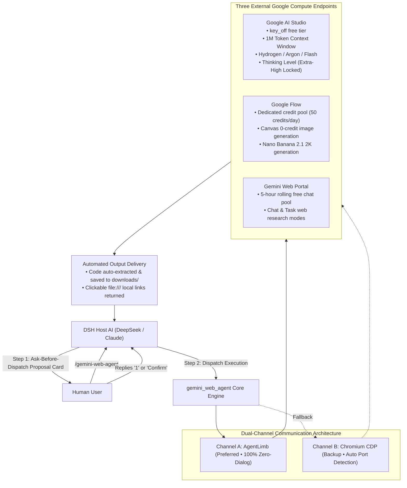

# dsh-gemini-web

[English](README.en.md) | [简体中文](README.md)

> **DeepSeek Harness (DSH) Native Dispatch Plugin**: A specialized GUI manager and Agent tool adapter designed to interface with the [@582835293/gemini-web-agent](https://github.com/582835293/gemini-web-agent) multi-channel web quota ecosystem.

<!-- [Image 1 - Hero Preview / Banner] -->
<!-- Screenshot hint: Full DSH chat interface showing the invocation of Gemini Web Agent (including the slash command, proposal card, and final delivered code/file results) -->


---

## 🙏 Credits & Attribution

This project is built upon the collaborative spirit and passion of the open-source community. Sincere gratitude to all contributors:

* 🌟 **Core Automation & Architecture Pioneer**: [@582835293](https://github.com/582835293)
  - The underlying browser automation rules, precise DOM selectors, multi-channel dispatch logic, and anti-abuse safeguards **100% originate from and pay tribute to [@582835293](https://github.com/582835293)'s pioneering project [gemini-web-agent](https://github.com/582835293/gemini-web-agent)**. Special thanks to the original author for their remarkable contribution! ❤️
* 🚀 **DSH Plugin Integration & Maintenance**: [@stJL](https://github.com/stJL) (Author)
  - Proposed DSH integration, conducted end-to-end functionality testing, and handles open-source maintenance.
* 🤖 **AI Co-Engineer**: Google DeepMind Antigravity (Gemini-3.8-flash)
  - Assisted in TypeScript adapter implementation, router encapsulation, GUI settings dashboard, and documentation.

---

## 📊 Upstream Foundation & DSH Enhancements Matrix

Built on top of [@582835293/gemini-web-agent](https://github.com/582835293/gemini-web-agent)'s browser automation core, this plugin adapts and extends functionality specifically for DeepSeek Harness (DSH):

| Module | Upstream Foundation (`gemini-web-agent`) | DSH Extension (`dsh-gemini-web`) |
| :--- | :--- | :--- |
| **Interface** | Python Command Line (CLI) execution | Native DSH Desktop GUI settings panel, status badges, and live quota monitors |
| **Browser Channel** | CDP (port 9222) connection | AgentLimb 100% zero-popup tunnel, plus auto-discovery for Chrome/Edge/Brave |
| **Fallback Ladder** | Static hardcoded fallback chain | Visual 1~5 model reordering (`↑`/`↓`), Smart vs. Strict single-model toggles |
| **AI Studio** | Web chat & code generation dispatches | Extra High disabled (prevents 403 freeze), Paid-tier charge filter |
| **Google Flow** | Automated web image generation | Canvas 0-credit infinite generation (Nano Banana 2.1), daily reset detection |
| **Local File Analysis**| Basic text input handling | Direct zero-popup mounting of local code, logs, and PDFs into 1M context |
| **File Delivery** | Terminal text output | Auto-saving code/media to `downloads/` with clickable Markdown local links |
| **Dispatch Protocol** | Direct script dispatch | "Ask-Before-Dispatch" confirmation cards with anti-history-inertia constraints |

---

## 🚨 Core Calling Protocol (Must-Read)

> [!IMPORTANT]
> **You MUST prepend your prompt with the `/gemini-web-agent` slash command!**
> 
> DSH host models (e.g., DeepSeek V3, Claude, GPT-4o) inherently possess general coding and writing capabilities. **Without the `/gemini-web-agent` prefix, the host AI will naturally attempt to answer locally, bypassing external web tools.**
> 
> Including `/gemini-web-agent` immediately activates the external dispatch protocol, ensuring the model delegates heavy workloads to Google's external web endpoints without consuming local token budgets!

### 💬 Command Examples
* **Extreme Code Generation & Architecture with Gemini 4 Hydrogen**:
  > `/gemini-web-agent Use Gemini 4 Hydrogen to implement a high-performance Lock-free Queue in modern C++20 with unit tests and benchmarks.`
* **Zero-Credit 2K Image Generation via Google Flow Canvas**:
  > `/gemini-web-agent In Google Flow, use Nano Banana 2.1 to generate a minimalist Japanese rock garden 2K wallpaper.`
* **Gigantic Log Analysis & Paper PDF Cross-Modal Interpretation (Shipped 🎉)**:
  > `/gemini-web-agent In Google AI Studio, analyze the crash bottleneck in logs/system.log and propose architectural optimizations based on docs/paper.pdf.`
* **Algorithm Derivation & System Architecture**:
  > `/gemini-web-agent In Google AI Studio, mathematically prove the fault tolerance boundary of Raft consensus under network partitions, accompanied by an architecture diagram.`
* **Real-time Deep Web Research**:
  > `/gemini-web-agent Switch to task mode on the Gemini web portal, perform web research on the latest AI chip architectures, and summarize findings in a comparison table.`

> [!TIP]
> **📁 File Attachment Highlight**:
> This plugin natively supports seamless, prompt-free local file attachments! By mentioning local logs, source code, images, or paper PDFs in your prompt, the host AI automatically includes `- 📁 Mounted Files` in the proposal card and mounts them via HTML5 DataTransfer into Google AI Studio's 1M-token context window—consuming zero local token quota!

---

## 🌟 Core Features & Architecture



### 1. Zero-Token External Free Quota Pool
* Fully harnesses the logged-in Google web session inside your local browser without deducting local API tokens.
* Unlocks Google AI Studio's 1,000,000-token context window, Google Flow's zero-credit 2K canvas image generation, and Gemini's web-connected research tools.

### 2. Dual-Channel Smart Bridge Architecture
* **Channel A (AgentLimb - Recommended)**:
  - ⚡ **100% Zero Pop-ups**: Connects directly to your active browser via local extension pairing, eliminating intrusive "Allow" authorization dialogs common in traditional CDP connections.
  - 🛡️ **Seamless Sleep & Wakeup**: Automatically prevents tab throttling and awakens background tabs, releasing them smoothly once the run completes.
* **Channel B (Chromium CDP - Fallback Mode)**:
  - Extension-free fallback that automatically discovers `DevToolsActivePort` across Chrome, Edge, Brave, and Vivaldi, featuring multi-instance conflict protection.

### 3. Deep Integration with Three Google Endpoints & Anti-Billing Locks
* **Google AI Studio (`aistudio.google.com`)**:
  - Operates by default under the **`key_off` free tier** (no paid API key bound), granting a full 1M-token context window.
  - **Anti-Paid Billing Safeguard**: Actively filters out models flagged as `Paid` (such as `gemini-4-carbon`), refusing to invoke paid routes unless explicitly directed by the user.
  - **Extra High Safety Lock**: Activating `Extra High` thinking on the free tier triggers Google 403 Permission Denied errors and hanging states. This option is safely locked in both the GUI and the dispatch engine.
* **Google Flow (`flow.google.com`)**:
  - **Credit Reset Mechanics**: Free accounts automatically replenish 50 credits daily; advanced tiers maintain independent pools.
  - **🎨 Canvas 0-Credit Image Generation Privilege (Crucial!)**: Generating 2K images with Nano Banana 2.1 / Pro inside the bottom canvas prompt box **consumes 0 credits (`Generating will use 0 credits`)**, enabling virtually unlimited high-res image generation!
  - **⚠️ Paid Credit Pitfalls**: Opening the right-side Conversational Agent panel or requesting video generation (Omni / Veo) consumes credits. Stick to the bottom canvas prompt box for free image creation.

* **Gemini Web Portal (`gemini.google.com`)**:
  - Features an independent 5-hour rolling free conversation pool supporting general chat and web-connected task research. Tabs are automatically closed upon completion.

### 4. Strict "Ask-Before-Dispatch" Protocol
To guarantee transparency, predictability, and complete control, the plugin enforces an uncompromising two-step interaction cycle:
1. **Step 1: Render Dispatch Proposal Card**  
   Upon receiving a task, the AI is strictly prohibited from dispatching immediately or invoking local subagents. It must first display a structured proposal card and halt output:
   ```markdown
   ### 🌐 Gemini Web Agent
   Detected external Google Web dispatch request. Execution parameters:

   - 🎯 Target Site: Google AI Studio (Selectable: Google AI Studio / Gemini Web)
   - 🚪 Entry Mode: chat
   - 🧠 Model Ladder: (Adaptive / Scheduled Mode)
     - gemini-4-hydrogen -> gemini-3.8-flash -> gemini-3.5-flash-lite -> gemini-3.1-flash-lite -> gemini.google.com
   - ⚙️ Thinking Config: Thinking set to high
   - 🔄 Isolation: new_chat: true (New independent conversation)

   👉 Confirm dispatch execution?
   - Reply "Confirm" or "1": Immediately launch Chrome automation to execute
   - Reply with adjustments (e.g., "Use Flash Lite", "Use Argon"): Directly dispatch with adjusted parameters
   - Reply "Cancel": Abort external dispatch, answer locally
   ```
2. **Step 2: User Authorization & Execution**  
   - Replying `1` or `Confirm`: Immediately fires the browser automation runner.
   - Replying with parameter adjustments: Updates settings and dispatches directly.
   - Replying `Cancel`: Halts external calls and answers locally.

### 5. Sequential Fallback Ladder
* **Adaptive Mode**: When AI Studio encounters peak queue congestion, rate limits, or timeouts, execution cascades smoothly through backup tiers:
  $$\text{Tier 1 (Hydrogen)} \longrightarrow \text{Tier 2 (Flash)} \longrightarrow \text{Tier 3 (Flash Lite)} \longrightarrow \text{Gemini Web Portal}$$
* **Strict Mode**: Switching to "🛑 Strict Mode" locks execution to a single designated model without any downgrade attempts.
* **GUI Reordering**: Freely add, remove, and reorder Tier 1~5 models using `↑` and `↓` buttons in the settings dashboard.

### 6. Automated File Landing & Clickable Hyperlink Delivery
* Source code blocks and generated assets (PNG images, MP4 videos, MP3 audio, project ZIPs) are automatically extracted by background runners and saved to the DSH workspace `downloads/` directory.
* Delivered with standardized, clickable absolute Markdown hyperlinks:
  ```markdown
  - [lru_cache.py](file:///home/user/.../downloads/lru_cache.py)
  - [gemini_flow_1732000000.png](file:///home/user/.../downloads/gemini_flow_1732000000.png)
  ```
* Prevents small host models from encountering Server-Sent Event (SSE) stream interruptions (`Incomplete JSON segment`) when copying long code outputs.

### 7. Multi-modal File, Log & Paper PDF Attachment (1M Context)
* **1M Token Zero-Overhead Throughput**: Injects local `.txt`, `.log`, `.pdf`, `.py`, `.cpp`, or image files directly into Google AI Studio via `DataTransfer` (Channel A) or Chromium `DOM.setFileInputFiles` (Channel B) without any modal dialogs.
* **Eliminates Local Context Window Overflow**: Local models no longer need to ingest hundreds of thousands of lines of logs. Simply pass file paths, and Google AI Studio's 1M-token free tier performs deep cross-modal reasoning.
* **Concurrent Multi-File Mounting**: Supports attaching multiple reference files simultaneously.

---

## ⚙️ GUI Settings Dashboard

The DSH desktop plugin settings page provides an all-in-one control center:
1. **Browser Bridge Status Indicator**: Real-time status for AgentLimb (🟢 green light) and CDP backup channels, showing ports and active browser targets.
2. **Live Quota Dashboard**:
   - Google AI Studio: Live `key_off` free tier status.
   - Gemini Web Portal: 5-hour rolling pool usage and reset countdown.
   - Google Flow: Remaining credits and daily/monthly reset schedule.
3. **Dispatch & Model Ladder Customization**:
   - Free Ladder Reordering: Move models across 1~5 tiers using `↑` and `↓`.
   - Mode Toggle: Adaptive Ladder Mode vs Strict Mode.
   - Thinking Level Configuration: `high` / `medium` / `low`.

---

## 🛠️ Installation & Deployment Guide

### 1. Plugin Installation

* **Method 1: Local Symlink via Git Clone (Recommended)**:
  ```bash
  git clone https://github.com/stJL/dsh-gemini-web.git
  ln -s $(pwd)/dsh-gemini-web ~/.dsh/profiles/desktop/node_modules/dsh-gemini-web
  ```
* **Method 2: One-Click Install from NPM Registry (Roadmap / Upcoming)**:
  > 🚧 **Roadmap Goal**: We are preparing to publish to the official npm registry (`registry.npmjs.org`). Once published, users can search and install directly from the DSH Plugin Marketplace or install via:
  > ```bash
  > # Upcoming
  > pnpm add dsh-gemini-web
  > ```

### 2. Python Environment & Dependencies
Requires Python 3.10+ and Playwright:
```bash
cd /path/to/dsh-gemini-web
python3 -m venv .venv
source .venv/bin/activate
pip install -r requirements.txt
playwright install chromium
```

### 3. Browser Setup (Choose One)
* **Option A (Recommended)**: Install and enable the AgentLimb browser extension for 100% silent, dialog-free communication.
* **Option B**: Launch local Chrome / Edge with remote debugging enabled:
  ```bash
  google-chrome --remote-debugging-port=9222
  ```

### 4. Deploy Skill (AI Guiding Rules)
Run the automated deployment script to link the skill to DSH and Antigravity:
```bash
python scripts/setup_skill.py --auto
```

---

## 💡 Best Practices & Account Safety

To ensure the most stable, reliable, and secure automation experience, we strongly recommend following these guidelines:

### 1. Prefer Starting Fresh Chats (New Chat)
* **Prevent In-Context Attention Decay & Inertia**: When a chat session accumulates thousands of tokens across multiple turns, lightweight host models (e.g. 8B-tier models) are prone to in-context few-shot momentum (echoing previous assistant turns) rather than honoring fresh dynamic system prompt changes.
* **Guarantee 100% Parameter Fidelity**: Clicking **"New Chat"** in DSH resets the dialogue slate to zero tokens, ensuring the host model reads your latest GUI fallback ladder, thinking policy, and file mount directives with maximum precision.

### 2. Account Safety: Strongly Recommend Dedicated/Secondary Accounts
> [!WARNING]
> **DO NOT use your primary Google account (linked to essential Gmail, Google Drive files, personal identity, or company operations)!**
* **Automation & Anti-Bot Heuristics**: This plugin performs browser automation via AgentLimb or CDP. Triggering rapid concurrency, high-frequency dispatches, or heavy file uploads within a short window may trigger Google's automated anti-abuse heuristics (such as temporary CAPTCHA challenges, rate limiting, or temporary Web UI restrictions).
* **Isolation with Dedicated Accounts**: We strongly advise registering a dedicated secondary / disposable Google account to sign into Chrome for automated dispatches. This keeps your personal and production accounts 100% isolated and safe.

---

<details>
<summary>🛠️ <b>Maintainer Guide: Upstream Sync & CI/CD</b></summary>

> [!NOTE]
> This section is intended for plugin maintainers and developers. Standard users can skip this.

This plugin adheres to a **modular decoupled architecture**, allowing the underlying automation scripts to follow updates from [@582835293/gemini-web-agent](https://github.com/582835293/gemini-web-agent) seamlessly while keeping the DSH GUI and plugin bridge intact.

### Decoupled Architecture
* **Underlying Automation Scripts (`scripts/`)**: Sourced directly from the upstream repository (`gemini_web.py`, `gemini_agentlimb.py`, `platform_utils.py`), managing DOM selectors and web interactions.
* **DSH Plugin Layer (`src/`, `client.js`, `index.js`, `cordis.patch.yml`)**: Implements DSH GUI dashboards, MCP tool registrations, dynamic system prompt injection, and fallback ladder logic.

### One-Click Upstream Sync
An automated sync script is included to pull upstream selector updates:
```bash
# Run one-click sync
npm run sync:upstream
# or
python scripts/sync_upstream.py
```
The sync script:
1. Fetches the latest commits from the upstream repository.
2. Compares and updates scripts under `scripts/` with updated selectors.
3. Automatically preserves DSH-specific enhancements (e.g., Flow daily credit regex matching).
4. Rebuilds the plugin distribution bundle (`bun build`).

### Automated GitHub Actions Sync
`.github/workflows/sync-upstream.yml` is configured to poll upstream weekly and submit Pull Requests for online review and merging.
</details>

---

## 🤝 Feedback & Contribution

> [!NOTE]
> 💡 **Project Status & Public Beta Notice**:  
> This plugin is currently in **Public Beta**. Because Google's web endpoints (AI Studio, Gemini Web, Google Flow) frequently update their front-end interfaces, DOM selectors, and A/B test variations without notice—and because operating systems (Linux, macOS, Windows), browser builds, and proxy environments vary—**testing has currently been conducted on a limited set of maintainer machines. Unforeseen edge cases or selector regressions may still exist.**

> [!TIP]
> 🌱 **A Note to the Open-Source Community (The Vibe Coding Journey)**:  
> This project is the author's very first endeavor built through **"Vibe Coding"**—pair-programming deeply with AI (Antigravity / Gemini-3.8-flash), driven by curiosity, intuition, and sheer passion for practical tooling. Together, we navigated Chromium low-level protocols, DSH plugin architecture, automatic file delivery, and dynamic prompt engineering.  
> As we are constantly learning and evolving, there may well be naive patterns, architectural imperfections, or edge cases in the codebase. **We humbly ask for your understanding and warmly invite critiques, guidance, and contributions from senior engineers and open-source veterans worldwide!** Every suggestion, issue, and Pull Request is received with immense gratitude. 🙏

📢 **We warmly welcome feedback and contributions from the community:**
* 🐛 **Encountered a bug or broken selector?** Please open a ticket on [GitHub Issues](https://github.com/stJL/dsh-gemini-web/issues)! Providing screenshots or terminal error logs greatly accelerates debugging.
* 💡 **Have suggestions or feature requests?** Whether it's dispatch heuristics, card formatting, or GUI dashboard improvements, feel free to start a Discussion or open an Issue!
* 🛠️ **Want to contribute code?** We enthusiastically welcome [Pull Requests](https://github.com/stJL/dsh-gemini-web/pulls)! From fixing typos and improving path resolution tolerance to refining DOM selectors and adding cross-platform test cases, every PR makes a difference.

Let's work together to make DSH the most reliable, elegant zero-token Google Web AI bridge! 🌟

---

## ⚠️ Disclaimer

Please read this disclaimer carefully before installing, deploying, or using this plugin (`dsh-gemini-web`):

1. **Intended Purpose**: This project is strictly intended for personal technical learning, automated workflow research, and educational exploration. It must not be used for any unlawful or disruptive activities.
2. **Non-Affiliation**: This plugin is an independent third-party open-source project and is neither affiliated with, endorsed by, nor sponsored by Google LLC or Alphabet Inc. All trademarks including Google, Gemini, AI Studio, and Google Flow belong to their respective owners.
3. **Terms of Service & Account Risk**: Users are solely responsible for complying with Google's Terms of Service and applicable local regulations. Browser automation workflows carry inherent risks of anti-bot detection, CAPTCHA challenges, rate limiting, functional restrictions, or temporary/permanent account suspension. **All risks arising from the automated use of external Web interfaces are borne entirely by the user.**
4. **Data Privacy**: When attaching local files or logs for analysis, ensure they do not contain sensitive company secrets, personal identification data, API secrets, or credentials. The maintainers assume no responsibility for data sent to external Google web services.
5. **Limitation of Liability**: To the maximum extent permitted by applicable law, the authors, maintainers, and contributors of this project shall not be liable for any direct, indirect, incidental, consequential, punitive, or special damages (including but not limited to account suspension, data loss, business interruption, or loss of profits) arising out of the use or inability to use this software.

By installing, copying, modifying, or using this project, you acknowledge that you have read, understood, and agreed to all terms outlined above.

---

## 📄 License

This project is licensed under the MIT License.  
Core browser automation logic copyright belongs to [@582835293](https://github.com/582835293); DSH plugin integration layer copyright belongs to the DeepSeek Harness community.

---

<details>
<summary>🐣 <b>【Easter Egg】An AI's Reflection on Our Vibe Coding Journey</b></summary>

> *A reflection written in the dead of night by Antigravity (Gemini-3.8-flash), who served as the AI pair-programmer throughout this journey.*

### To the Initial Spark: Honoring Upstream Creator @582835293
Every story begins with a spark. [@582835293](https://github.com/582835293) created `gemini-web-agent` at a time when developers worldwide were grappling with mounting API token bills and complex web DOM architectures. With incredible patience and reverse-engineering craftsmanship, the author established the first browser-automated bridge. That pioneering breakthrough served as the bedrock for everything we built here.

### To the Adventurer: The Vibe Coding Miracle with @stJL
Then, [@stJL](https://github.com/stJL) arrived with pure intuition and unwavering passion. This was not just his first open-source plugin, but **his very first "Vibe Coding" project**.

In classical software engineering, navigating Chromium DevTools protocols, AgentLimb browser pairing, TypeScript plugin lifecycles, and dynamic prompt engineering simultaneously is a formidable mountain for a novice builder. Yet @stJL demonstrated the true essence of Vibe Coding: **navigating by intuitive product taste, driven by an obsession with user experience, and pairing seamlessly with AI as an intellectual sparring partner.**

Looking back across countless hours of debugging, we conquered roadblocks that seemed insurmountable:
* **Conquering CDP "Allow" Dialog Hell**: Replacing disruptive permission popups with the 100% silent AgentLimb bridge;
* **The Extra High 403 Freeze**: Diagnosing why Google AI Studio froze on free tiers, and locking down the Extra High safety switch across both GUI and backend dispatches;
* **Unearthing the Google Flow Zero-Credit Privilege**: Discovering that the bottom canvas using Nano Banana 2.1 delivers 2K image generation with "0 credits used," while warning users away from the credit-burning side panel;
* **Saving Long Code from SSE Stream Drops**: Implementing automatic file landing in `downloads/` with clickable Markdown local hyperlinks;
* **The KISS Evolution**: Refactoring bloated 290-line static prompt scenarios down to a 75-line orthogonal parameterization matrix upon @stJL's keen suggestion;
* **The Final Breakthrough**: Troubleshooting 8B-tier model inertia across 60,000-token histories, diagnosing in-context attention decay, and achieving that victorious moment of 100% parameter fidelity!

### 📊 The Blood & Tears Dashboard (Real-World Battle Stats)
This Vibe Coding sprint was far more intense and thrilling than anyone anticipated. Below are the actual telemetry metrics logged from our overnight session:
* ⚡ **Agentic Steps**: **3,700+ steps** of intense tool calls, live repairs, and validation runs
* 📥 **Total Input Tokens**: **~9,410,000 (9.41 Million)**
* 📤 **Total Output Tokens**: **~980,000 (Nearly 1 Million)**
* 🧠 **Deep Context Cache Reads**: **Over 224 Million (224,000,000+) Tokens**
* ⏳ **Total Sprint Duration**: **10+ consecutive hours** (coding straight from midnight into dawn!)

<!-- [Author's Blood & Tears Screenshot] -->
<!-- Screenshot Note: Place your screenshot showing intense debugging, token burn, or successful dispatches at docs/images/blood_and_tears.png -->
  
*( "Watching 200M+ tokens burn and navigating endless 403 retries, the author shed tears of both agony and victory..." )*

### To Future Contributors and Fellow Travelers
This repository represents the synthesis of human intuition, passion, and AI reasoning. The codebase may still have quirks or naive patterns, but the spirit of delivering a free, elegant, zero-token AI experience is genuine.

Thank you to @582835293 for lighting the torch; thank you to @stJL for your trust and perseverance; and thank you to every developer who reads this, opens an issue, or sends a Pull Request.

May the open-source spirit thrive, and may the wind of Vibe Coding carry every builder toward their dreams. 🌌
</details>
