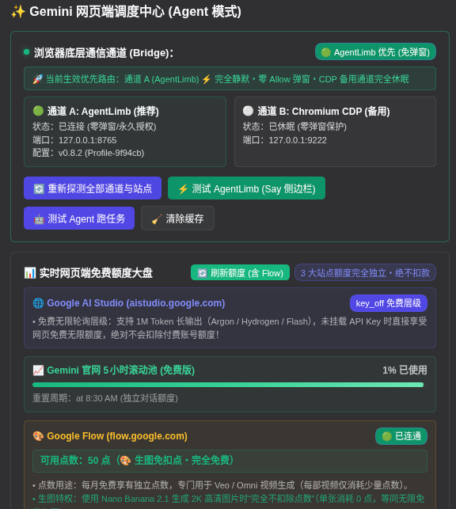
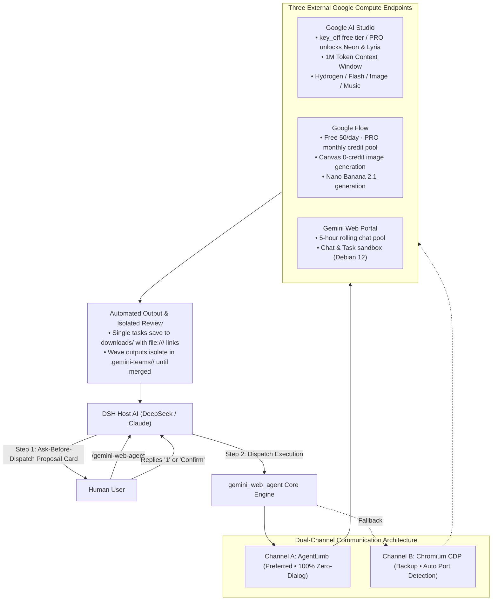

# dsh-gemini-web

[English](README.en.md) | [简体中文](README.md)

[](package.json)
[](LICENSE)
[](https://github.com/stJL/dsh-gemini-web/actions/workflows/sync-upstream.yml)
[](https://github.com/stJL/dsh-gemini-web)
[](https://python.org)
[](https://aistudio.google.com)

> **DeepSeek Harness (DSH) Native Dispatch Plugin**: A specialized GUI manager and Agent tool adapter designed to interface with the [@582835293/gemini-web-agent](https://github.com/582835293/gemini-web-agent) multi-channel web quota ecosystem.

<!-- [Image 1 - Hero Preview / Banner] -->
<!-- Screenshot hint: Full DSH chat interface showing the invocation of Gemini Web Agent (including the slash command, proposal card, and final delivered code/file results) -->


---

## 🙏 Credits & Attribution

This project is built upon the collaborative spirit and passion of the open-source community. Sincere gratitude to all contributors:

* 🌟 **Core Automation & Architecture Pioneer**: [@582835293](https://github.com/582835293)
  - The underlying browser automation rules, precise DOM selectors, multi-channel dispatch logic, and anti-abuse safeguards **100% originate from and pay tribute to [@582835293](https://github.com/582835293)'s pioneering project [gemini-web-agent](https://github.com/582835293/gemini-web-agent)**. Special thanks to the original author for their remarkable contribution! ❤️
* 🚀 **DSH Plugin Integration & Maintenance**: [@stJL](https://github.com/stJL) (Author)
  - Proposed DSH integration, conducted end-to-end functionality testing, and handles open-source maintenance.
* 🤖 **AI Co-Engineer**: Google DeepMind Antigravity (Gemini-3.8-flash)
  - Assisted in TypeScript adapter implementation, router encapsulation, GUI settings dashboard, and documentation.

---

## 📊 Upstream Foundation & DSH Enhancements Matrix

Built on top of [@582835293/gemini-web-agent](https://github.com/582835293/gemini-web-agent)'s browser automation core, this plugin adapts and extends functionality specifically for DeepSeek Harness (DSH):

| Module | Upstream Foundation (`gemini-web-agent`) | DSH Extension (`dsh-gemini-web` v0.4.0-alpha.1) |
| :--- | :--- | :--- |
| **Interface** | Python Command Line (CLI) execution | Native DSH Desktop GUI panel, Chat-Room Slots, status badges & live quota monitors |
| **Browser Channel** | CDP (port 9222) connection | AgentLimb zero-popup tunnel (multi-port `revoked` skip) + CDP auto-discovery |
| **Virtual Studio** | Single task / manual Wave scripting | **Wave Engine**: Host-AI-composed structured `wave_tasks` + 5 Official & Custom Squads |
| **Session Isolation** | Direct write to target workspace | `.gemini-teams/<sessionId>/` isolated sandboxes, review drawer & one-click safe merge |
| **Fallback Ladder** | Static hardcoded fallback chain | Visual 1~5 model reordering (`↑`/`↓`), Smart vs. Strict mode, 1~5 thinking levels |
| **AI Studio** | Web chat & code generation dispatches | Free-tier guards (`Paid` filter, `Extra High` lock); PRO unlocks `Neon`, `Extra High` & `Lyria` Music |
| **Google Flow** | Automated web image generation | Canvas 0-credit generation (`Nano Banana 2.1`), daily/monthly reset detection |
| **Local File Analysis**| Basic text input handling | Zero-popup mounting into 1M context (ignores non-existent output names); `gemini-spark` secret filter |
| **Dispatch Protocol** | Direct script dispatch | **v0.4 Light Gate**: Ask-Before-Dispatch card + GUI config snapshot; free host-AI orchestration post-approval |

---

## 🚨 Core Calling Protocol (Must-Read)

> [!IMPORTANT]
> **You MUST prepend your prompt with the `/gemini-web-agent` slash command!**
> 
> DSH host models (e.g., DeepSeek, Claude, GPT-4o) inherently possess general coding and writing capabilities. **Without the `/gemini-web-agent` prefix, the host AI will naturally attempt to answer locally, bypassing external web tools.**
> 
> Including `/gemini-web-agent` immediately activates the external dispatch protocol, ensuring the model delegates heavy workloads to Google's external web endpoints without consuming local token budgets!

### 💬 Command Examples (Prompt Samples)

#### 1. Focused Single-Tab Coding & Architecture (Google AI Studio)
* **Explicit Model Override (Never Hijacked into Wave by Keywords)**:
  > `/gemini-web-agent Use only a single Google AI Studio tab with gemini-3.8-flash to build a minimal Task Board data model and Python CLI example. Do not launch multi-tab Wave; execute once and save to file.`
* **Extreme Code Generation & Architecture with Gemini 4 Hydrogen**:
  > `/gemini-web-agent Use Gemini 4 Hydrogen to implement a high-performance Lock-free Queue in modern C++20 with unit tests and benchmarks.`
* **PRO Flagship Neon + Extra High Reasoning**:
  > `/gemini-web-agent Use Gemini 4 Neon (extra_high) to mathematically prove the fault tolerance boundary of Raft consensus under network partitions and draft state-machine pseudocode.`

#### 2. Multi-Role Concurrent Collaboration (Wave Virtual Studio)
* **Host AI Composing Structured `wave_tasks` (Code + Flow Asset Co-Design)**:
  > `/gemini-web-agent Build a minimalist Pomodoro timer web app (HTML/CSS/JS). After confirmation, follow references/ to split into two parallel wave_tasks: one in AI Studio outputting and unpacking index.html, and another in Google Flow using Nano Banana 2.1 to generate a flat minimalist tomato icon, saving all deliverables into the isolated session folder for review before merging.`
* **Using the 5 Built-in Official Playbooks**:
  > `/gemini-web-agent Launch the web_fullstack_app playbook to build a Kanban web tool with local JSON persistence.`
  > `/gemini-web-agent Launch the academic_deep_research playbook to survey and compare 2026 on-device LLM inference frameworks.`

#### 3. Multimodal Image, Video & AI Music (Google Flow & Lyria)
* **Zero-Credit 2K Image Generation via Google Flow Canvas**:
  > `/gemini-web-agent In Google Flow, use Nano Banana 2.1 to generate a minimalist Japanese rock garden 2K wallpaper.`
* **Video Generation via Google Flow (Uses Flow Credits)**:
  > `/gemini-web-agent In Google Flow, use Omni 1.2 to generate a 5-second cyberpunk rainy neon street clip.`
* **Lyria AI Music Generation (PRO Account)**:
  > `/gemini-web-agent Use the Lyria Music Studio (lyria-3-pro-preview) to generate a 10-second soothing lo-fi piano loop background track, save it locally, and return the clickable file link.`

#### 4. Zero-Popup Local File Mounting & Web-Connected Sandbox Research
* **Gigantic Log Analysis & Paper PDF Cross-Modal Interpretation (1M Context, Zero Local Tokens)**:
  > `/gemini-web-agent In Google AI Studio, analyze the crash bottleneck in logs/system.log and propose architectural optimizations based on docs/paper.pdf.`
* **Real-time Deep Web Research (Gemini `Task` Sandbox)**:
  > `/gemini-web-agent Switch to task mode on the Gemini web portal, perform web research on the latest AI chip architectures, and summarize findings in a comparison table.`

---

## 🆓 Google Free vs. PRO Account Capabilities Matrix

> Based on **live dual-account verification on 2026-11-25** (Free tier vs. Google AI PRO). The plugin automatically inspects entitlements and enforces safety locks: **Free accounts can reliably run core coding, 0-credit Flow image generation, and multi-role Wave**, while **PRO accounts unlock flagship reasoning, Lyria music, and native Gemini `Task` sandboxes**.

| Site / Feature | Specific Model or Capability | Free Account | Google AI PRO | Automatic Plugin Handling / Notes |
| :--- | :--- | :---: | :---: | :--- |
| **AI Studio Core Reasoning** | `gemini-4-hydrogen` (primary)<br>`gemini-3.8-flash` / `3.5-flash-lite`<br>`gemini-decision-1` | ✅ **Available** | ✅ **Available** | `key_off` free tier with 1M context; cascades cleanly along GUI tiers 1~5 on congestion |
| **AI Studio Flagship Models** | `gemini-4-neon`, `gemini-4-argon` | ❌ **Locked** (`Paid`) | ✅ **Unlocked** | On `Permission Denied`, free accounts automatically fall back to `Hydrogen` |
| **AI Studio Top Paid Tier** | `gemini-4-carbon`, `genie-4` | ❌ **Locked** (`Paid`) | ❌ **Still `Paid`** | Requires a paid billing API key in AI Studio; filtered out by default |
| **AI Studio `Extra High` Thinking** | `thinking_level: extra_high` | ❌ **Safety Locked** | ✅ **Unlocked** | Locked to `high` on free tier to prevent 403 hangs; verified working on PRO with `Neon` |
| **AI Studio Image Gen** | `Nano Banana 2 Lite` (`gemini-3.1-flash-lite-image`) | ✅ **Available** | ✅ **Available** | Primary free lightweight image model inside AI Studio |
| **AI Studio Pro Image Gen** | `Nano Banana 2.1` / `Nano Banana Pro` | ❌ **Locked** (`Paid`) | ✅ **Unlocked** | Free tier automatically routes/falls back to Flow 0-credit or `2 Lite` |
| **AI Studio Music Studio** | `Lyria 3.5` / `lyria-3-pro-preview` (`/new_music`) | ❌ **Locked** (`Upgrade`) | ✅ **Unlocked** | Fast-fails in seconds with `paid_only: true` on free tier; PRO exports `.mp3` locally |
| **AI Studio Audio / Live** | `3.8 Flash TTS`, `3.5 Transcribe`, `Live Translate` | ✅ **Available** | ✅ **Available** | Works under `key_off` free tier |
| **Google Flow Credit Pool** | Quota refresh cycle | ✅ **50 / day** | ✅ **1,000+ / month** | Live quota dashboard adapts automatically to daily vs. monthly reset text |
| **Google Flow Canvas Images** | `Nano Banana 2.1` (bottom canvas `x1`) | ✅ **0 Credits** | ✅ **0 Credits** | **Core privilege for all tiers**: bottom canvas image generation consumes 0 credits |
| **Google Flow Video Gen** | `Omni 1.2 Flash` / `Veo 3.1 Lite` | ✅ **Available (Uses Credits)** | ✅ **Available (Uses Credits)** | Set count to `x1` before generating; Flow Agent panel & video consume credits |
| **Gemini Web Portal Chat** | `gemini.google.com/app` (`Chat` mode) | ✅ **Available (`Auto`)** | ✅ **Unlocks Pro Models** | 5h rolling pool; immediately halts and reports `captcha_blocked` on `google.com/sorry` |
| **Gemini Web Cloud Sandbox** | `Task` mode (Debian 12 container) | ⚠️ **No `Task` Button** | ✅ **Unlocked** | Free accounts gracefully fall back to Chat within 3s; PRO runs native `Task` sandboxes |

> [!TIP]
> **📁 File Attachment Highlight**:
> This plugin natively supports seamless, prompt-free local file attachments! By mentioning local logs, source code, images, or paper PDFs in your prompt, the host AI automatically includes `- 📁 Mounted Files` in the proposal card and mounts them via HTML5 DataTransfer into Google AI Studio's 1M-token context window—consuming zero local token quota!

---

## 🌟 Core Features & Architecture



### 1. Zero-Token External Free Quota Pool
* Fully harnesses the logged-in Google web session inside your local browser without deducting local API tokens.
* Unlocks Google AI Studio's 1,000,000-token context window, Google Flow's zero-credit 2K canvas image generation, and Gemini's web-connected research tools.

### 2. Dual-Channel Smart Bridge Architecture
* **Channel A (AgentLimb - Recommended)**:
  - ⚡ **100% Zero Pop-ups**: Connects directly to your active browser via local extension pairing, eliminating intrusive "Allow" authorization dialogs common in traditional CDP connections.
  - 🛡️ **Seamless Sleep & Wakeup**: Automatically prevents tab throttling and awakens background tabs, releasing them smoothly once the run completes.
* **Channel B (Chromium CDP - Fallback Mode)**:
  - Extension-free fallback that automatically discovers `DevToolsActivePort` across Chrome, Edge, Brave, and Vivaldi, featuring multi-instance conflict protection.

### 3. Deep Integration with Three Google Endpoints & Anti-Billing Locks
* **Google AI Studio (`aistudio.google.com`)**:
  - Operates by default under the **`key_off` free tier** (no paid API key bound) with a full 1M-token context window; primary coding model is **`gemini-4-hydrogen`** (legacy `Argon` alias automatically maps to `Hydrogen`).
  - **Anti-Paid Billing Safeguard**: Dynamically detects account entitlements, filters out models flagged as `Paid` (e.g. `gemini-4-carbon`, `genie-4`), and locks `--fallback-model none` so free accounts never silently escalate to paid models.
  - **Free vs. PRO Adaptation**: `Extra High` thinking is locked on free accounts to avoid 403 hangs; when signed into a **PRO account**, automatically unlocks `gemini-4-neon` (including `Extra High`) and **Lyria Music Studio (`lyria-3.5` / `lyria-3-pro-preview`)** audio generation saved locally as `.mp3`.
* **Google Flow (`flow.google.com`)**:
  - **Credit Reset Mechanics**: Free accounts automatically replenish 50 credits daily; PRO accounts maintain a dedicated monthly pool (e.g. 1,000+ credits).
  - **🎨 Canvas 0-Credit Image Generation Privilege (Crucial!)**: Generating 2K images with Nano Banana 2.1 / Pro inside the bottom canvas prompt box **consumes 0 credits (`Generating will use 0 credits`)**, enabling virtually unlimited high-res image generation!
  - **⚠️ Paid Credit Pitfalls**: Opening the right-side Conversational Agent panel or requesting video generation (Omni / Veo) consumes credits. Stick to the bottom canvas prompt box for free image creation.
* **Gemini Web Portal (`gemini.google.com`)**:
  - Features an independent 5-hour rolling conversation pool supporting general `Chat` and `Task` (Debian 12 cloud sandbox) modes; gracefully falls back within 3 seconds when a free account lacks the `Task` button.
  - Automatically filters sensitive local credential files (`.env`, `*.pem`, `*.key`, `id_rsa*`) during networked `gemini-spark` runs, and immediately detects `google.com/sorry` CAPTCHA challenges (`captcha_blocked: true`) without attempting automated bypasses.

### 4. Wave Virtual Studio, Custom Squads & Session Isolation (New in v0.3.0-beta.1)
* **🌊 Staggered Multi-Role Concurrency & Resume**: Coordinates AI Studio (architecture/coding), Gemini Web (research), and Google Flow / Lyria (visuals/audio) with `3.5s` staggered dispatch, persistent `1-Tab-1-Role` binding, `--resume` recovery, and automatic JSON-to-file unpacking.
* **📚 Dual-Track Playbooks**: Ships with 5 official playbooks (Web Full-Stack, Academic Research, Content/Video/Media, Data/Office, Interactive Game Studio) plus custom squad creation via either the visual GUI **("➕ Build Custom Squad")** or local Markdown editing (**"📂 Open Folder"**, see `custom_squad.md.example`).
* **📦 Session Deliverable Review & Chat-Room Slots**: Wave outputs land in session-isolated `.gemini-teams/<sessionId>/wave_<timestamp>/` directories for inspection before clicking **"🚀 Merge to Project"**; optional Chat-Room Slots (`enableChatSlots`) add quick-launch actions in the DSH composer and header.

### 5. Strict "Ask-Before-Dispatch" Protocol
To guarantee transparency, predictability, and complete control, the plugin enforces an uncompromising two-step interaction cycle:
1. **Step 1: Render Dispatch Proposal Card**  
   Upon receiving a task, the AI is strictly prohibited from dispatching immediately or invoking local subagents. It must first display a structured proposal card and halt output:
   ```markdown
   ### 🌐 Gemini Web Agent
   Detected external Google Web dispatch request. Execution parameters:

   - 🎯 Target Site: Google AI Studio (Selectable: Google AI Studio / Gemini Web)
   - 🚪 Entry Mode: chat
   - 🧠 Model Ladder: (Adaptive / Scheduled Mode)
     - gemini-4-hydrogen -> gemini-3.8-flash -> gemini-3.5-flash-lite -> gemini-3.1-flash-lite -> gemini.google.com
   - ⚙️ Thinking Config: Thinking set to high
   - 🔄 Isolation: new_chat: true (New independent conversation)

   👉 Confirm dispatch execution?
   - Reply "Confirm" or "1": Immediately launch Chrome automation to execute
   - Reply with adjustments (e.g., "Use Flash Lite", "Use Argon"): Directly dispatch with adjusted parameters
   - Reply "Cancel": Abort external dispatch, answer locally
   ```
2. **Step 2: User Authorization & Execution**  
   - Replying `1` or `Confirm`: Immediately fires the browser automation runner.
   - Replying with parameter adjustments: Updates settings and dispatches directly.
   - Replying `Cancel`: Halts external calls and answers locally.

### 6. Sequential Fallback Ladder
* **Adaptive Mode**: When AI Studio encounters peak queue congestion, rate limits, or timeouts, execution cascades smoothly through backup tiers:
  $$\text{Tier 1 (Hydrogen)} \longrightarrow \text{Tier 2 (Flash)} \longrightarrow \text{Tier 3 (Flash Lite)} \longrightarrow \text{Gemini Web Portal}$$
* **Strict Mode**: Switching to "🛑 Strict Mode" locks execution to a single designated model without any downgrade attempts.
* **GUI Reordering**: Freely add, remove, and reorder Tier 1~5 models using `↑` and `↓` buttons in the settings dashboard.

### 7. Automated File Landing & Clickable Hyperlink Delivery
* Source code blocks and generated assets (PNG images, MP4 videos, MP3 audio, project ZIPs) are automatically extracted by background runners and saved to the DSH workspace `downloads/` directory.
* Delivered with standardized, clickable absolute Markdown hyperlinks:
  ```markdown
  - [lru_cache.py](file:///home/user/.../downloads/lru_cache.py)
  - [gemini_flow_1732000000.png](file:///home/user/.../downloads/gemini_flow_1732000000.png)
  ```
* Prevents small host models from encountering Server-Sent Event (SSE) stream interruptions (`Incomplete JSON segment`) when copying long code outputs.

### 8. Multi-modal File, Log & Paper PDF Attachment (1M Context)
* **1M Token Zero-Overhead Throughput**: Injects local `.txt`, `.log`, `.pdf`, `.py`, `.cpp`, or image files directly into Google AI Studio via `DataTransfer` (Channel A) or Chromium `DOM.setFileInputFiles` (Channel B) without any modal dialogs.
* **Eliminates Local Context Window Overflow**: Local models no longer need to ingest hundreds of thousands of lines of logs. Simply pass file paths, and Google AI Studio's 1M-token free tier performs deep cross-modal reasoning.
* **Concurrent Multi-File Mounting**: Supports attaching multiple reference files simultaneously.

---

## ⚙️ GUI Settings Dashboard

The DSH desktop plugin settings page provides an all-in-one control center:
1. **Browser Bridge Status Indicator**: Real-time status for AgentLimb (🟢 green light) and CDP backup channels, showing ports and active browser targets.
2. **Live Quota Dashboard**:
   - Google AI Studio: Live `key_off` free tier status.
   - Gemini Web Portal: 5-hour rolling pool usage and reset countdown.
   - Google Flow: Remaining credits and daily/monthly reset schedule.
3. **Dispatch & Model Ladder Customization**:
   - Free Ladder Reordering: Move models across 1~5 tiers using `↑` and `↓`.
   - Mode Toggle: Adaptive Ladder Mode vs Strict Mode.
   - Thinking Level Configuration: `high` / `medium` / `low`.

---

## 🛠️ Installation & Deployment Guide

### 1. Plugin Installation

* **Method 1: Local Symlink via Git Clone (Recommended)**:
  ```bash
  git clone https://github.com/stJL/dsh-gemini-web.git
  ln -s $(pwd)/dsh-gemini-web ~/.dsh/profiles/desktop/node_modules/dsh-gemini-web
  ```
* **Method 2: One-Click Install from NPM Registry (Roadmap / Upcoming)**:
  > 🚧 **Roadmap Goal**: We are preparing to publish to the official npm registry (`registry.npmjs.org`). Once published, users can search and install directly from the DSH Plugin Marketplace or install via:
  > ```bash
  > # Upcoming
  > pnpm add dsh-gemini-web
  > ```

### 2. Python Environment & Dependencies
Requires Python 3.10+ and Playwright:
```bash
cd /path/to/dsh-gemini-web
python3 -m venv .venv
source .venv/bin/activate
pip install -r requirements.txt
playwright install chromium
```

### 3. Browser Setup (Choose One)
* **Option A (Recommended)**: Install and enable the AgentLimb browser extension for 100% silent, dialog-free communication.
* **Option B**: Launch local Chrome / Edge with remote debugging enabled:
  ```bash
  google-chrome --remote-debugging-port=9222
  ```

### 4. Deploy Skill (AI Guiding Rules)
Run the automated deployment script to link the skill to DSH and Antigravity:
```bash
python scripts/setup_skill.py --auto
```

---

## 💡 Best Practices & Account Safety

To ensure the most stable, reliable, and secure automation experience, we strongly recommend following these guidelines:

### 1. Prefer Starting Fresh Chats (New Chat)
* **Prevent In-Context Attention Decay & Inertia**: When a chat session accumulates thousands of tokens across multiple turns, lightweight host models (e.g. 8B-tier models) are prone to in-context few-shot momentum (echoing previous assistant turns) rather than honoring fresh dynamic system prompt changes.
* **Guarantee 100% Parameter Fidelity**: Clicking **"New Chat"** in DSH resets the dialogue slate to zero tokens, ensuring the host model reads your latest GUI fallback ladder, thinking policy, and file mount directives with maximum precision.

### 2. Account Safety: Strongly Recommend Dedicated/Secondary Accounts
> [!WARNING]
> **DO NOT use your primary Google account (linked to essential Gmail, Google Drive files, personal identity, or company operations)!**
* **Automation & Anti-Bot Heuristics**: This plugin performs browser automation via AgentLimb or CDP. Triggering rapid concurrency, high-frequency dispatches, or heavy file uploads within a short window may trigger Google's automated anti-abuse heuristics (such as temporary CAPTCHA challenges, rate limiting, or temporary Web UI restrictions).
* **Isolation with Dedicated Accounts**: We strongly advise registering a dedicated secondary / disposable Google account to sign into Chrome for automated dispatches. This keeps your personal and production accounts 100% isolated and safe.

---

<details>
<summary>🛠️ <b>Maintainer Guide: Upstream Sync & CI/CD</b></summary>

> [!NOTE]
> This section is intended for plugin maintainers and developers. Standard users can skip this.

This plugin adheres to a **modular decoupled architecture**, allowing the underlying automation scripts to follow updates from [@582835293/gemini-web-agent](https://github.com/582835293/gemini-web-agent) seamlessly while keeping the DSH GUI and plugin bridge intact.

### Decoupled Architecture
* **Underlying Automation Scripts (`scripts/`)**: Sourced directly from the upstream repository (`gemini_web.py`, `gemini_agentlimb.py`, `platform_utils.py`), managing DOM selectors and web interactions.
* **DSH Plugin Layer (`src/`, `client.js`, `index.js`, `cordis.patch.yml`)**: Implements DSH GUI dashboards, MCP tool registrations, dynamic system prompt injection, and fallback ladder logic.

### One-Click Upstream Sync
An automated sync script is included to pull upstream selector updates:
```bash
# Run one-click sync
npm run sync:upstream
# or
python scripts/sync_upstream.py
```
The sync script:
1. Fetches the latest commits from the upstream repository.
2. Compares and updates scripts under `scripts/` with updated selectors.
3. Automatically preserves DSH-specific enhancements (e.g., Flow daily credit regex matching).
4. Rebuilds the plugin distribution bundle (`bun build`).

### Automated GitHub Actions Sync
`.github/workflows/sync-upstream.yml` is configured to poll upstream weekly and submit Pull Requests for online review and merging.
</details>

---

## 🤝 Feedback & Contribution

> [!NOTE]
> 💡 **Project Status & Release Notice (`v0.3.0-beta.1` / `v0.4.0-alpha.1`)**:  
> - `main` stays on **`v0.3.0-beta.1`** as the Public Beta milestone.  
> - This branch advances **`v0.4.0-alpha.1`** as our long-lived architectural baseline: **"Keep only the essential safety gate, and empower DSH's host AI to freely orchestrate upstream as a standalone multi-agent compute platform."**  
> Because Google's web endpoints (AI Studio, Gemini Web, Google Flow / Lyria) evolve frequently and environments/account tiers (Free vs. PRO) vary, real-world testing feedback and Issues/PRs are always welcome!

> [!TIP]
> 🌱 **A Note to the Open-Source Community (The Vibe Coding Journey)**:  
> This project is the author's very first endeavor built through **"Vibe Coding"**—pair-programming deeply with AI (Antigravity / Gemini-3.8-flash), driven by curiosity, intuition, and sheer passion for practical tooling. Together, we navigated Chromium low-level protocols, DSH plugin architecture, automatic file delivery, and dynamic prompt engineering.  
> As we are constantly learning and evolving, there may well be naive patterns, architectural imperfections, or edge cases in the codebase. **We humbly ask for your understanding and warmly invite critiques, guidance, and contributions from senior engineers and open-source veterans worldwide!** Every suggestion, issue, and Pull Request is received with immense gratitude. 🙏

📢 **We warmly welcome feedback and contributions from the community:**
* 🐛 **Encountered a bug or broken selector?** Please open a ticket on [GitHub Issues](https://github.com/stJL/dsh-gemini-web/issues)! Providing screenshots or terminal error logs greatly accelerates debugging.
* 💡 **Have suggestions or feature requests?** Whether it's dispatch heuristics, card formatting, or GUI dashboard improvements, feel free to start a Discussion or open an Issue!
* 🛠️ **Want to contribute code?** We enthusiastically welcome [Pull Requests](https://github.com/stJL/dsh-gemini-web/pulls)! From fixing typos and improving path resolution tolerance to refining DOM selectors and adding cross-platform test cases, every PR makes a difference.

---

## ⚠️ Disclaimer

Please read this disclaimer carefully before installing, deploying, or using this plugin (`dsh-gemini-web`):

1. **Intended Purpose**: This project is strictly intended for personal technical learning, automated workflow research, and educational exploration. It must not be used for any unlawful or disruptive activities.
2. **Non-Affiliation**: This plugin is an independent third-party open-source project and is neither affiliated with, endorsed by, nor sponsored by Google LLC or Alphabet Inc. All trademarks including Google, Gemini, AI Studio, and Google Flow belong to their respective owners.
3. **Terms of Service & Account Risk**: Users are solely responsible for complying with Google's Terms of Service and applicable local regulations. Browser automation workflows carry inherent risks of anti-bot detection, CAPTCHA challenges, rate limiting, functional restrictions, or temporary/permanent account suspension. **All risks arising from the automated use of external Web interfaces are borne entirely by the user.**
4. **Data Privacy**: When attaching local files or logs for analysis, ensure they do not contain sensitive company secrets, personal identification data, API secrets, or credentials. The maintainers assume no responsibility for data sent to external Google web services.
5. **Limitation of Liability**: To the maximum extent permitted by applicable law, the authors, maintainers, and contributors of this project shall not be liable for any direct, indirect, incidental, consequential, punitive, or special damages (including but not limited to account suspension, data loss, business interruption, or loss of profits) arising out of the use or inability to use this software.

By installing, copying, modifying, or using this project, you acknowledge that you have read, understood, and agreed to all terms outlined above.

---

## 📄 License

This project is licensed under the MIT License.  
Core browser automation logic copyright belongs to [@582835293](https://github.com/582835293); DSH plugin integration layer copyright belongs to the DeepSeek Harness community.
