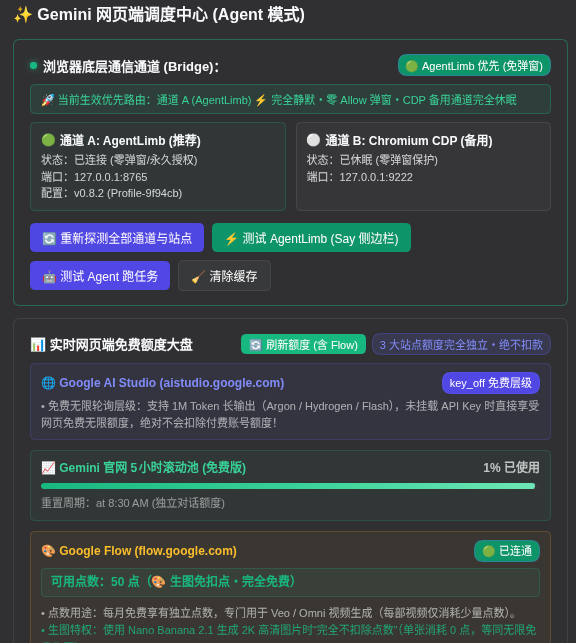
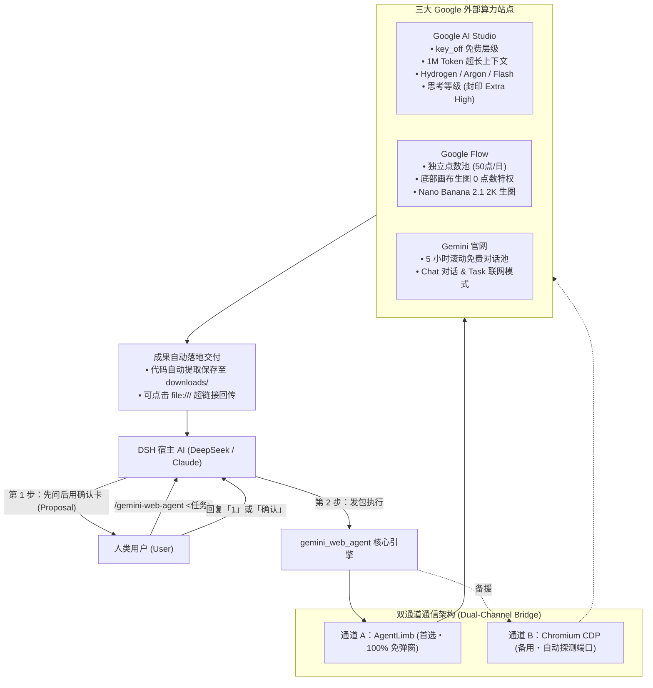

# dsh-gemini-web

[简体中文](README.md) | [English](README.en.md)

[](package.json)
[](LICENSE)
[](https://github.com/stJL/dsh-gemini-web/actions/workflows/sync-upstream.yml)
[](https://github.com/stJL/dsh-gemini-web)
[](https://python.org)
[](https://aistudio.google.com)

> **DeepSeek Harness (DSH) 原生调度插件**：专为接入 [@582835293/gemini-web-agent](https://github.com/582835293/gemini-web-agent) 多渠道网页额度生态而设计的 GUI 管理器与 Agent 工具适配器。

<!-- [图片 1 - 顶部效果预览 / Hero Banner] -->
<!-- 截图提示：DSH 聊天室中调用 Gemini Web Agent 的完整界面截图（含指令、先问后用确认卡与代码落地结果） -->


---

## 🙏 致谢与开源声明 (Credits & Attribution)

本项目诞生于开源社区的深度协同与热爱，特此向所有贡献者致以最诚挚的感谢：

* 🌟 **底层核心自动化与架构探索**：[@582835293](https://github.com/582835293)
  - 本插件底层核心浏览器自动化规则、DOM 选择器精准调校、多渠道调度逻辑与风控防护策略**100% 传承并致敬原作者 [@582835293](https://github.com/582835293) 的开源项目 [gemini-web-agent](https://github.com/582835293/gemini-web-agent)**。向原作的开拓性贡献致敬！❤️
* 🚀 **DSH 插件整合与维护**：[@stJL](https://github.com/stJL) (我)
  - 提出 DSH 整合想法，负责插件适配、全流程功能实测与开源维护。
* 🤖 **AI 协同编程**：Google DeepMind Antigravity (Gemini-3.8-flash)
  - 协助编写插件适配代码、封装路由、构建 GUI 设置面板与文档整理。

---

## 📊 功能分工与特性对照表

本项目基于原作者 [@582835293/gemini-web-agent](https://github.com/582835293/gemini-web-agent) 的底层浏览器自动化能力，为 DeepSeek Harness (DSH) 桌面端进行适配与功能扩展：

| 功能模块 | 原作者基础 (`gemini-web-agent`) | 本插件扩展 (`dsh-gemini-web`) |
| :--- | :--- | :--- |
| **操作界面** | Python 命令行（CLI）执行 | DSH 桌面端可视化设置面板、状态指示灯与实时额度显示 |
| **通信通道** | CDP（9222 端口）连接 | 整合 AgentLimb 零弹窗通道，支持 Chrome/Edge/Brave 等多浏览器探测 |
| **模型阶梯** | 固定的模型降级链 | GUI 自定义 1~5 阶模型排序（`↑`/`↓`）、切换智能阶梯或严格模式 |
| **AI Studio** | 网页对话与代码生成调度 | 停用 Extra High 防 403 假死、过滤 Paid 付费标签模型 |
| **Google Flow** | 网页自动化生图 | 默认底栏画布生图（0 点数消耗）、适配每日点数重置检测 |
| **本地文件分析** | 基础文本输入 | 支持本地代码/日志/PDF 直接挂载至网页端 1M 窗口分析 |
| **文件保存与交付**| 文本输出于终端 | 代码与媒体文件自动存档至 `downloads/`，生成本地超链接 |
| **调度流程** | 脚本直接发包 | 「先问后用」确认卡机制，并在提示词中加入抗历史惯性约束 |

---

## 🚨 核心召唤规范（必读）

> [!IMPORTANT]
> **必须在提示词开头输入 `/gemini-web-agent` 斜杠指令！**
> 
> DSH 宿主 AI（如 DeepSeek、Claude、GPT 等）本身具备通用的代码与文本生成能力。**若不加上 `/gemini-web-agent`，AI 会倾向于在本地直接作答，直接忽略外部工具**。
> 
> 只要在提示词开头加上 `/gemini-web-agent`，宿主 AI 就会立刻触发调度协议，严格执行流程，将任务委派给外部 Google 网页端执行！

### 💬 召唤指令范例
* **调用 Hydrogen 极限代码生成与架构设计**：
  > `/gemini-web-agent 用 Gemini 4 Hydrogen 帮我实现高性能无锁队列 (Lock-free Queue)，并附带完整中文注释与单元测试`
* **Google Flow 画布 0 点数高清生图**：
  > `/gemini-web-agent 在 Google Flow 用 Nano Banana 2.1 生一张极简日式枯山水庭园 2K 壁纸`
* **巨型日志分析与论文 PDF 跨模态解读**：
  > `/gemini-web-agent 用 Google AI Studio 帮我分析 logs/system.log 的崩溃瓶颈，并对比 docs/paper.pdf 的架构提出优化方案`
* **极限算法推导与系统架构规划**：
  > `/gemini-web-agent 用 Google AI Studio 帮我推导分布式 Raft 共识算法在网络分区时的极限容错证明，并输出架构图`
* **时效性深度联网调研**：
  > `/gemini-web-agent 在 Gemini 官网切换至 task 模式，联网调研最新 AI 芯片架构进展并做成对比表格`

> [!TIP]
> **📁 文件挂载特性亮点**：
> 本插件已完整打通「本机文件免弹窗挂载 (File Attachment)」！在提示词中指定本地日志、代码、图片或论文 PDF，宿主 AI 会在提案卡中自动标记 `- 📁 挂载文件`，并自动通过 DataTransfer / CDP 注入 Google AI Studio 1M 超大上下文进行推演，不耗费本机宿主模型的输入 Token！

---

## 🌟 核心特性与架构



### 1. 零 Token 外部免费算力池
* 充分利用本机浏览器已登录之 Google 账号网页端免费用量，不耗费本机任何 API Token 配额。
* 支持 Google AI Studio 1M 超大上下文、Google Flow 画布高清生图与 Gemini 官网联网任务。

### 2. 双通道智能路由架构 (Dual-Channel Smart Bridge)
* **通道 A (AgentLimb - 推荐首选)**：
  - ⚡ **100% 免弹窗**：基于本机配对协议直接操控已开启之浏览器，彻底告别传统 CDP 连接时频繁跳出的「Allow」授权弹窗。
  - 🛡️ **无感休眠唤醒**：自动启用标签页防冻结与唤醒机制，任务结束自动释放。
* **通道 B (Chromium CDP - 备用模式)**：
  - 免装扩展程序，自动探测遍历 Chrome、Edge、Brave、Vivaldi 等浏览器的 DevToolsActivePort，具备多实例防冲突机制。

### 3. 三大站点深度支持与免扣费安全锁
* **Google AI Studio (`aistudio.google.com`)**：
  - 默认工作于 **`key_off` 免费无限轮询层级**（左上角未绑定付费 API Key），享受 1M Token 超长上下文输出。
  - **防 Paid 扣费铁律**：插件强制过滤并锁定所有标记为 `Paid` 的付费模型（如 `gemini-4-carbon`），非用户显式指定绝不调用。
  - **Extra High 安全锁**：免费层级若开启 `Extra High` 思考会引发 Google 403 错误与排队假死。本插件在前端 GUI 与底层调度中将 `Extra High` 上锁。
* **Google Flow (`flow.google.com`)**：
  - **点数重置机制**：免费账号每日定期自动补满 50 点，进阶账号每月享有专属点数池。
  - **🎨 画布 0 点数生图特权（重要！）**：在底部标准画布（Canvas）提示词框使用 Nano Banana 2.1 / Pro 生成 2K 高清图片时，**完全不扣除点数（Generating will use 0 credits）**，等同无限免费生图！
  - **⚠️ 扣点避坑提醒**：点开右侧 Conversational Agent 对话面板（Agent 模式）或点击生成视频（Omni / Veo）时会扣除点数，日常纯生图请认准底栏画布生成。
* **Gemini 官网 (`gemini.google.com`)**：
  - 独立 5 小时滚动免费对话池，支持日常对话与 Task 联网任务，任务完成自动关闭标签页。

### 4. 严格「先问后用」工作流 (Ask-Before-Dispatch)
为确保透明、可控与零意外花费，插件严格遵循规范的「先问后用」交互流程：
1. **第 1 步：呈现调度提案卡**  
   AI 接收到任务后，严禁直接发包或偷开本地 subagent，必须先输出结构化确认卡，并立即结束当次回显等待用户指令：
   ```markdown
   ### 🌐 Gemini Web Agent
   检测到您欲调用外部 Google 网页端实现并发任务，相关配置如下：

   - 🎯 执行渠道：Google AI Studio（可选择：Google AI Studio / Gemini Web）
   - 🚪 入口模式：chat
   - 🧠 执行模型：（智能/定时模式）
     - gemini-4-hydrogen -> gemini-3.8-flash -> gemini-3.5-flash-lite -> gemini.google.com
   - ⚙️ 推演配置：Thinking 设为 high
   - 🔄 话题隔离：new_chat: true（默认开启全新独立对话）

   👉 请确认是否发包执行？
   - 回复 「确认」 或 「1」：立即调用外部 Chrome 自动化发包执行
   - 回复 调整参数（如「改用 Flash Lite」、「改用 Argon」等）：按您的要求调整后直接发包
   - 回复 「取消」：中止外部调度，改由本地作答
   ```
2. **第 2 步：用户授权发包**  
   - 回复 `1` 或 `确认`：立即调用外部 Chrome 执行发包。
   - 回复 调整参数：AI 立即按最新参数直接发包。
   - 回复 `取消`：中止外部调度，改由本地直接回答。

### 5. 阶梯备援降级机制 (Sequential Fallback Ladder)
* **智能模式**：在 AI Studio 遭遇尖峰拥堵、限流或超时时，自动沿着梯队平滑降级：
  $$\text{Tier 1 (Hydrogen)} \longrightarrow \text{Tier 2 (Flash)} \longrightarrow \text{Tier 3 (Flash Lite)} \longrightarrow \text{Gemini 官网}$$
* **严格模式**：若用户在设置中切换为「🛑 严格模式」，则锁定单一模型，不进行任何降级。
* **GUI 自由调整**：在设置面板中可自由增删 1~5 阶模型，并通过 `↑` / `↓` 按钮直观调整模型优先级顺序。

### 6. 代码自动落地与点击式超链接交付
* 网页端生成的代码块与生成的媒体文件（PNG 图片、MP4 视频、MP3 音乐、项目 ZIP 包）由后台程序自动提取并落地保存至 DSH 工作区的 `downloads/` 目录。
* 输出标准可点击的本地绝对路径 Markdown 超链接：
  ```markdown
  - [lru_cache.py](file:///home/user/.../downloads/lru_cache.py)
  - [gemini_flow_1732000000.png](file:///home/user/.../downloads/gemini_flow_1732000000.png)
  ```
* 避免全量长代码在聊天窗口大量重抄导致小模型 SSE 流截断（Incomplete JSON segment）。

### 7. 本机文件、日志与论文 PDF 免弹窗挂载分析 (Multi-modal File Attachment)
* **1M Token 零开销吞吐**：通过底层 `DataTransfer`（通道 A）与 Chromium 原生 `DOM.setFileInputFiles`（通道 B），直接将本机的 `.txt`、`.log`、`.pdf`、`.py`、`.cpp` 或图片免弹窗上传至 Google AI Studio 进行端到端多模态解析。
* **彻底规避本机 Context 溢出**：本机宿主模型无需在聊天对话框中重抄或吞吐十万行日志文本，只需传入文件路径，由 Google AI Studio 免费层级（100 万 Token 窗口）全权推演分析并回传结论！
* **多文件并行挂载**：支持一次性挂载多份参考文档或对比文件。

---

## ⚙️ GUI 设置大盘功能

在 DSH 桌面端的插件设置页面中提供了一站式仪表盘：
1. **浏览器通信状态灯**：实时检测 AgentLimb（🟢 绿灯）与 CDP 备用通道连接状态、调试端口与浏览器类型。
2. **实时额度大盘**：
   - Google AI Studio：显示 `key_off` 免费层级状态。
   - Gemini 官网：显示 5 小时滚动池已用量与重置周期。
   - Google Flow：显示当前剩余点数与每日/每月重置倒计时。
3. **调度与模型梯队配置**：
   - 梯队自由排序：支持 1~5 阶模型上下移动（`↑` / `↓`）。
   - 模式切换：智能阶梯模式 vs 严格模式。
   - 思考等级配置：`high` / `medium` / `low`。

---

## 🛠️ 安装与部署指南

### 1. 插件安装

* **方式一：Git Clone 本地软链接（目前推荐）**：
  ```bash
  git clone https://github.com/stJL/dsh-gemini-web.git
  ln -s $(pwd)/dsh-gemini-web ~/.dsh/profiles/desktop/node_modules/dsh-gemini-web
  ```
* **方式二：NPM 官方源一键安装（即将推出 / Roadmap 规划中）**：
  > 🚧 **待实现目标**：本项目正筹备发布至 npm 官方源 `registry.npmjs.org`。发布完成后，届时将支持直接在 DSH 桌面端插件市场搜索一键安装，或通过命令行安装：
  > ```bash
  > # 即将支持 (Upcoming)
  > pnpm add dsh-gemini-web
  > ```

### 2. Python 环境与依赖
插件依赖 Python 3.10+ 与 Playwright 驱动：
```bash
cd /path/to/dsh-gemini-web
python3 -m venv .venv
source .venv/bin/activate
pip install -r requirements.txt
playwright install chromium
```

### 3. 浏览器准备（二选一）
* **方案 A（推荐）**：安装并启用 AgentLimb 浏览器扩展，享受 100% 免弹窗静默通信。
* **方案 B**：以调试模式启动本机 Chrome / Edge：
  ```bash
  google-chrome --remote-debugging-port=9222
  ```

### 4. 部署 Skill（AI 指导规范）
执行内置部署脚本，自动将 Skill 注册至 DSH 与 Antigravity：
```bash
python scripts/setup_skill.py --auto
```

---

## 💡 使用建议与最佳实践 (Best Practices & Account Safety)

为确保您获得最稳定、流畅且安全的自动化调度体验，强烈建议遵循以下实践原则：

### 1. 建议优先开启全新独立对话 (Prefer New Chat)
* **规避长上下文与注意力衰减**：当前聊天室的历史轮次累积过长时（尤其是超过数万 Token），轻量级宿主模型（如 8B 级别的小模型）极易受到上一轮历史助手的输出惯性吸引（In-Context Few-Shot Bias），进而可能忽略顶部最新动态提示词。
* **确保实时配置百分之百生效**：在 DSH 左侧随时点击 **「新建对话（New Chat）」**，能彻底清除历史对话的干扰，确保宿主 AI 100% 严格以您在 GUI 面板中设置的最新模型降级顺序、思考等级与挂载参数进行输出。

### 2. 账号安全：强烈建议使用专用/备用 Google 账号 (Use Secondary Accounts)
> [!WARNING]
> **切勿使用绑定了重要个人隐私、公司业务、核心 Gmail 邮箱或 Google Drive 关键文件的日常主力账号！**
* **自动化行为与风控机制**：本插件本质上属于浏览器自动化辅助工具（通过 AgentLimb 或 CDP 驱动）。若在短时间内触发大量并发调度、极高频发包或密集挂载超大文件，Google 服务器的安全风控机制可能会触发临时人机验证（CAPTCHA）、请求频率限制（Rate Limit），甚至可能导致账号在网页端暂时无法使用。
* **专用测试账号隔离**：强烈建议专门注册一个或多个**独立的备用/测试 Google 账号（Secondary / Disposable Account）**登录 Chrome 浏览器来进行插件调度。这样即便遇到临时频率风控，也不会对您的日常生活与工作产生任何不良影响。

---

<details>
<summary>🛠️ <b>维护者指南：上游同步与 CI/CD (Maintainer Guide)</b></summary>

> [!NOTE]
> 本节内容仅供插件维护者开发使用，普通用户无需执行。

本插件采用**模块化分离架构**，让底层自动化脚本能无痛跟进原作者 [@582835293/gemini-web-agent](https://github.com/582835293/gemini-web-agent) 的更新，同时保证 DSH GUI 与插件核心不受影响。

### 架构分离设计
* **底层自动化脚本 (`scripts/`)**：源自原作者仓库（`gemini_web.py`、`gemini_agentlimb.py`、`platform_utils.py` 等），负责 DOM 选择器与网页交互。
* **DSH 插件专属层 (`src/`, `client.js`, `index.js`, `cordis.patch.yml`)**：负责 DSH GUI 面板、MCP 服务注册、动态 Prompt 注入与阶梯降级逻辑。

### 一键同步指令
我们在项目中提供了自动化同步脚本，随时拉取原作者最新选择器修复：
```bash
# 执行一键同步脚本
npm run sync:upstream
# 或
python scripts/sync_upstream.py
```
同步脚本会自动完成：
1. 从原作者 GitHub 上游仓库获取最新代码。
2. 比对并更新 `scripts/` 下的自动化脚本与最新选择器。
3. 自动保留 DSH 增强特性（如 Flow 每日点数重置正则适配）。
4. 重新构建插件产物（`bun build`）。

### GitHub Actions 自动同步
本项目已配置 `.github/workflows/sync-upstream.yml`，每周自动检查上游更新并产生 PR，维护者可直接在 GitHub 线上审核合并。详细的本地兼容性测试流程请参阅 [docs/UPSTREAM_SYNC_GUIDE.md](docs/UPSTREAM_SYNC_GUIDE.md)。
</details>

---

## 🤝 欢迎参与测试、反馈与贡献 (Feedback & Contribution)

> [!NOTE]
> 💡 **项目状态与测试声明**：  
> 本插件目前处于**公开测试阶段（Public Beta）**。由于 Google 各大网页端（AI Studio、Gemini 官网、Google Flow）的前端界面与 DOM 结构会不定期进行 A/B 测试或静默更新，加上不同操作系统的使用者（Linux / macOS / Windows）、浏览器版本、网络环境及代理策略各不相同，**目前仅由维护者在有限的本地环境进行实测，代码中难免存在尚未被发现的边界情况（Edge Cases）或潜在问题**。

> [!TIP]
> 🌱 **写给开源社区的一封信（关于 Vibe Coding）**：  
> 本项目是作者人生中**第一个真正意义上的「Vibe Coding」项目**——在与 AI（Antigravity / Gemini-3.8-flash）高频协同结对的过程中，以纯粹的直觉、热爱与工程探索驱动，一行行跨越了 Chromium 底层协议、DSH 生态适配、成果自动落盘交付与动态提示词工程。  
> 由于作者与 AI 在这场探索中仍处于不断学习与成长之中，若代码架构或实现细节中存在不够优雅、稚嫩或考虑不周之处，**恳请 GitHub 上的各路技术大神多多包涵、高抬贵手，更诚挚期盼您的指点与赐教**！无论是指出架构缺陷、提出重构建议，还是提交微小的修复 PR，我们都满怀敬畏与感激！🙏

📢 **我们非常渴望听见社区的声音，期待您的参与：**
* 🐛 **遇到 Bug 或调度失败？** 非常欢迎至 [GitHub Issues](https://github.com/stJL/dsh-gemini-web/issues) 提交反馈！请尽量附上错误日志或截图，我们会以最快速度排查与修复。
* 💡 **有更好的点子或优化建议？** 无论是调度策略、确认卡排版、UI 仪表盘交互，欢迎随时开启 Discussion 或发起 Issue 畅所欲言！
* 🛠️ **想一起完善代码？** 我们极度欢迎各路好手提交 [Pull Request](https://github.com/stJL/dsh-gemini-web/pulls)！无论是修复微小拼写、改善路径解析容错、优化 DOM 选择器适配，还是新增跨平台测试用例，每一个 PR 都是对开源社区巨大的帮助！

---

## ⚠️ 免责声明 (Disclaimer)

在安装、部署或使用本插件（`dsh-gemini-web`）之前，请务必仔细阅读本免责声明：

1. **用途声明**：本项目仅供个人技术学习、自动化整合研究与学术交流使用，切勿用于任何违反法律法规或恶意破坏服务的场景。
2. **非官方关联**：本插件为独立的第三方开源软件，与 Google LLC 及其母公司 Alphabet Inc. 不存在任何形式的官方关联、授权或背书。文中所提及的 Google、Gemini、AI Studio、Google Flow 等商标均归属于其各自的商标所有权人。
3. **服务条款与账号风险**：用户应自行遵守 Google 的《服务条款》（Terms of Service）、各项网页产品政策及所在国家/地区的法律规范。使用本工具进行浏览器自动化操作可能面临 Google 网页端的风控检测、人机验证挑战（CAPTCHA）、速率限制（Rate Limit）、功能降级或账号暂时/永久受限等风险。**所有因自动化调度行为引发的账号状态变更或服务中断风险，均由使用者本人完全自行承担。**
4. **数据安全与隐私**：在调度外部网页端或挂载本地文件时，请确保上传的文件不包含任何敏感商业机密、个人隐私数据、API 密钥或关键凭证。本项目不对上传至外部服务器的任何数据安全性承担责任。
5. **责任免除**：在适用法律允许的最大范围内，本项目的作者、维护者及社区贡献者概不对因使用、误用或无法使用本软件所引起的任何直接、间接、附带、衍生、惩罚性或特殊损失（包括但不限于账号封禁、数据丢失、业务中断、利润损失或计算机系统故障）承担任何法律责任。

一旦您安装、复制、修改或使用本项目，即表示您已完整阅读、理解并完全接受上述免责条款。

---

## 📄 授权条款 (License)

本项目遵循 MIT License。  
核心自动化逻辑版权归原作者 [@582835293](https://github.com/582835293) 所有，DSH 插件整合层归 DeepSeek Harness 社区所有。
