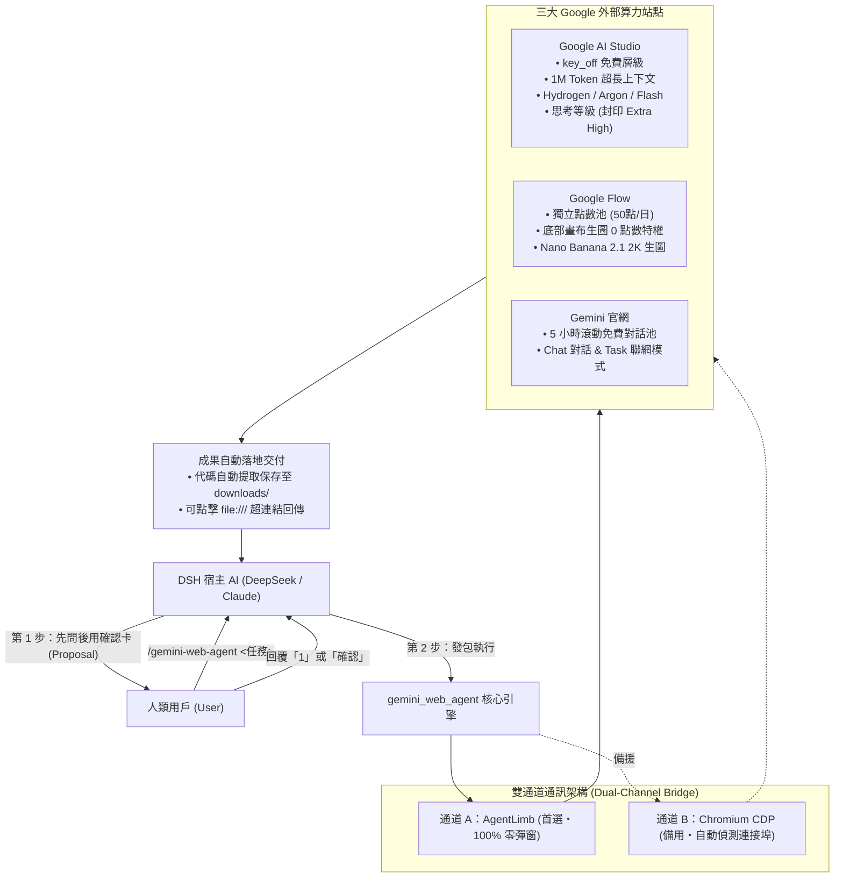

# dsh-gemini-web

[繁體中文](README.md) | [English](README.en.md)

> **DeepSeek Harness (DSH) 原生調度外掛**：專為接入 [@582835293/gemini-web-agent](https://github.com/582835293/gemini-web-agent) 多渠道網頁額度生態而設計的 GUI 管理器與 Agent 工具適配器。

<!-- [圖片 1 - 頂部效果預覽 / Hero Banner] -->
<!-- 截圖提示：DSH 聊天室中調用 Gemini Web Agent 的完整介面截圖（含指令、先問後用確認卡與代碼落地結果） -->


---

## 🙏 致謝與開源聲明 (Credits & Attribution)

本專案誕生於開源社群的深度協同與熱愛，特此向所有貢獻者致以最誠摯的感謝：

* 🌟 **底層核心自動化與架構探索**：[@582835293](https://github.com/582835293)
  - 本外掛底層核心瀏覽器自動化規則、DOM 選擇器精準調校、多渠道調度邏輯與風控防護策略**100% 傳承並致敬原作者 [@582835293](https://github.com/582835293) 的開源專案 [gemini-web-agent](https://github.com/582835293/gemini-web-agent)**。向原作者的開拓性貢獻致敬！❤️
* 🚀 **DSH 外掛整合與維護**：[@stJL](https://github.com/stJL) (我)
  - 提出 DSH 整合想法，負責外掛適配、全流程功能實測與開源維護。
* 🤖 **AI 協同編程**：Google DeepMind Antigravity (Gemini-3.8-flash)
  - 協助編寫外掛適配代碼、封裝路由、構建 GUI 設定面板與文檔整理。

---

## 📊 功能分工與特性對照表

本專案基於原作者 [@582835293/gemini-web-agent](https://github.com/582835293/gemini-web-agent) 的底層瀏覽器自動化能力，為 DeepSeek Harness (DSH) 桌面端進行適配與功能擴展：

| 功能模組 | 原作者基礎 (`gemini-web-agent`) | 本外掛擴展 (`dsh-gemini-web`) |
| :--- | :--- | :--- |
| **操作介面** | Python 命令行（CLI）執行 | DSH 桌面端視覺化設定面板、狀態燈號與即時額度顯示 |
| **通訊通道** | CDP（9222 端口）連接 | 整合 AgentLimb 零彈窗通道，支援 Chrome/Edge/Brave 等多瀏覽器偵測 |
| **模型階梯** | 固定的模型降級鏈 | GUI 自訂 1~5 階模型排序（`↑`/`↓`）、切換智能階梯或嚴格模式 |
| **AI Studio** | 網頁對話與代碼生成調度 | 停用 Extra High 防 403 假死、過濾 Paid 付費標籤模型 |
| **Google Flow** | 網頁自動化生圖 | 預設底欄畫布生圖（0 點數消耗）、適配每日點數重置檢測 |
| **本地檔案分析** | 基礎文字輸入 | 支援本地代碼/日誌/PDF 直接掛載至網頁端 1M 窗口分析 |
| **檔案保存與交付**| 文字輸出於終端 | 代碼與媒體檔案自動存檔至 `downloads/`，生成本地超連結 |
| **調度流程** | 腳本直接發包 | 「先問後用」確認卡機制，並在提示詞中加入抗歷史慣性約束 |

---

## 🚨 核心召喚規範（必讀）

> [!IMPORTANT]
> **必須在提示詞開頭輸入 `/gemini-web-agent` 斜槓指令！**
> 
> DSH 宿主 AI（如 DeepSeek V3、Claude、GPT 等）本身具備通用的代碼與文本生成能力。**若不加上 `/gemini-web-agent`，AI 會傾向於在本地直接作答，直接忽略外部工具**。
> 
> 只要在提示詞開頭加上 `/gemini-web-agent`，宿主 AI 就會立刻觸發調度協議，嚴格執行流程，將任務委派給外部 Google 網頁端執行！

### 💬 召喚指令範例
* **調用 Hydrogen 極限代碼生成與架構設計**：
  > `/gemini-web-agent 用 Gemini 4 Hydrogen 幫我實作高效能無鎖佇列 (Lock-free Queue)，並附帶完整繁中註釋與單元測試`
* **Google Flow 畫布 0 點數高清生圖**：
  > `/gemini-web-agent 在 Google Flow 用 Nano Banana 2.1 生一張極簡日式枯山水庭園 2K 桌布`
* **巨型日誌分析與論文 PDF 跨模態解讀**：
  > `/gemini-web-agent 用 Google AI Studio 幫我分析 logs/system.log 的崩潰瓶頸，並對比 docs/paper.pdf 的架構提出優化方案`
* **極限演算法推導與系統架構規劃**：
  > `/gemini-web-agent 用 Google AI Studio 幫我推導分散式 Raft 共識演算法在網路分區時的極限容錯證明，並輸出架構圖`
* **時效性深度聯網調研**：
  > `/gemini-web-agent 在 Gemini 官網切換至 task 模式，聯網調研最新 AI 晶片架構進展並做成對比表格`

> [!TIP]
> **📁 檔案掛載特性亮點**：
> 本外掛已完整打通「本機檔案無彈窗掛載 (File Attachment)」！在提示詞中指定本地日誌、代碼、圖片或論文 PDF，宿主 AI 會在提案卡中自動標記 `- 📁 掛載檔案`，並自動透過 DataTransfer / CDP 注入 Google AI Studio 1M 超大上下文進行推演，不耗費本機宿主模型的輸入 Token！

---

## 🌟 核心特性與架構



### 1. 零 Token 外部免費算力池
* 充分利用本機瀏覽器已登入之 Google 帳號網頁端免費用量，不耗費本機任何 API Token 配額。
* 支援 Google AI Studio 1M 超大上下文、Google Flow 畫布高清生圖與 Gemini 官網聯網任務。

### 2. 雙通道智慧路由架構 (Dual-Channel Smart Bridge)
* **通道 A (AgentLimb - 推薦首選)**：
  - ⚡ **100% 零彈窗**：基於本機配對協議直接操控已開啟之瀏覽器，徹底告別傳統 CDP 連線時頻繁跳出的「Allow」授權彈窗。
  - 🛡️ **無感休眠喚醒**：自動啟用標籤頁防凍結與喚醒機制，任務結束自動釋放。
* **通道 B (Chromium CDP - 備用模式)**：
  - 免裝擴充套件，自動偵測遍歷 Chrome、Edge、Brave、Vivaldi 等瀏覽器的 DevToolsActivePort，具備多實例防衝突機制。

### 3. 三大站點深度支援與免扣款安全鎖
* **Google AI Studio (`aistudio.google.com`)**：
  - 預設工作於 **`key_off` 免費無限輪詢層級**（左上角未綁定付費 API Key），享受 1M Token 超長上下文輸出。
  - **防 Paid 扣款鐵律**：外掛強制過濾並鎖定所有標記為 `Paid` 的付費模型（如 `gemini-4-carbon`），非用戶顯式指定絕不調用。
  - **Extra High 安全鎖**：免費層級若開啟 `Extra High` 思考會引發 Google 403 錯誤與排隊假死。本外掛在前端 GUI 與底層調度中將 `Extra High` 上鎖。
* **Google Flow (`flow.google.com`)**：
  - **點數重置機制**：免費帳號每日定期自動補滿 50 點，進階帳號每月享有專屬點數池。
  - **🎨 畫布 0 點數生圖特權（重要！）**：在底部標準畫布（Canvas）提示詞框使用 Nano Banana 2.1 / Pro 生成 2K 高清圖片時，**完全不扣除點數（Generating will use 0 credits）**，等同無限免費生圖！
  - **⚠️ 扣點避坑提醒**：點開右側 Conversational Agent 對話面板（Agent 模式）或點選生成影片（Omni / Veo）時會扣除點數，日常純生圖請認準底欄畫布生成。

<!-- [圖片 4 - Google Flow 畫布 0 點數特權特寫] -->
<!-- 截圖提示：截取 Google Flow 底部畫布輸入框中顯示「Generating will use 0 credits」的特寫，或 DSH 中成功接收生圖的預覽畫面 -->


* **Gemini 官網 (`gemini.google.com`)**：
  - 獨立 5 小時滾動免費對話池，支援日常對話與 Task 聯網任務，任務完成自動關閉分頁。

### 4. 嚴格「先問後用」工作流 (Ask-Before-Dispatch)
為確保透明、可控與零意外花費，外掛嚴格遵循規範的「先問後用」交互流程：
1. **第 1 步：呈現調度提案卡**  
   AI 接收到任務後，嚴禁直接發包或偷開本地 subagent，必須先輸出結構化確認卡，並立即結束當次回顯等待用戶指令：
   ```markdown
   ### 🌐 Gemini Web Agent
   檢測到您欲調用外部 Google 網頁端實現並發任務，相關配置如下：

   - 🎯 執行渠道：Google AI Studio（可選擇：Google AI Studio / Gemini Web）
   - 🚪 入口模式：chat
   - 🧠 執行模型：（智能/定時模式）
     - gemini-4-hydrogen -> gemini-3.8-flash -> gemini-3.5-flash-lite -> gemini.google.com
   - ⚙️ 推演配置：Thinking 設為 high
   - 🔄 話題隔離：new_chat: true（預設開啟全新獨立對話）

   👉 請確認是否發包執行？
   - 回覆 「確認」 或 「1」：立即調用外部 Chrome 自動化發包執行
   - 回覆 調整參數（如「改用 Flash Lite」、「改用 Argon」等）：按您的要求調整後直接發包
   - 回覆 「取消」：中止外部調度，改由本地作答
   ```
2. **第 2 步：用戶授權發包**  
   - 回覆 `1` 或 `確認`：立即調用外部 Chrome 執行發包。
   - 回覆 調整參數：AI 立即按最新參數直接發包。
   - 回覆 `取消`：中止外部調度，改由本地直接回答。

<!-- [圖片 2 - 先問後用確認卡互動演示] -->
<!-- 截圖提示：DSH 對話框截圖：第 1 輪用戶發出 /gemini-web-agent 需求 -> AI 回覆提案卡並停止；第 2 輪用戶回覆 1 -> AI 調用發包 -->


### 5. 階梯備援降級機制 (Sequential Fallback Ladder)
* **智能模式**：在 AI Studio 遭遇尖峰壅塞、限流或超時時，自動沿著梯隊平滑降級：
  $$\text{Tier 1 (Hydrogen)} \longrightarrow \text{Tier 2 (Flash)} \longrightarrow \text{Tier 3 (Flash Lite)} \longrightarrow \text{Gemini 官網}$$
* **嚴格模式**：若用戶在設定中切換為「🛑 嚴格模式」，則鎖定單一模型，不進行任何降級。
* **GUI 自由調整**：在設定面板中可自由增刪 1~5 階模型，並透過 `↑` / `↓` 按鈕直觀調整模型優先權順序。

### 6. 代碼自動落地與點擊式超連結交付
* 網頁端產生的代碼塊與生成的媒體檔案（PNG 圖片、MP4 影片、MP3 音樂、專案 ZIP 包）由背景程序自動提取並落地保存至 DSH 工作區的 `downloads/` 目錄。
* 輸出標準可點擊的本地絕對路徑 Markdown 超連結：
  ```markdown
  - [lru_cache.py](file:///home/user/.../downloads/lru_cache.py)
  - [gemini_flow_1732000000.png](file:///home/user/.../downloads/gemini_flow_1732000000.png)
  ```
* 避免全量長代碼在聊天視窗大量重抄導致小模型 SSE 串流截斷（Incomplete JSON segment）。

<!-- [圖片 5 - 成果文件落地與可點擊超連結] -->
<!-- 截圖提示：截取 DSH 聊天室末尾輸出的「成果文件已落地存檔至本地工作區」與 file:/// 超連結展示 -->


### 7. 本機檔案、日誌與論文 PDF 無彈窗掛載分析 (Multi-modal File Attachment)
* **1M Token 零開銷吞吐**：透過底層 `DataTransfer`（通道 A）與 Chromium 原生 `DOM.setFileInputFiles`（通道 B），直接將本機的 `.txt`、`.log`、`.pdf`、`.py`、`.cpp` 或圖片無彈窗上傳至 Google AI Studio 進行端到端多模態解析。
* **徹底規避本機 Context 溢出**：本機宿主模型無需在聊天對話框中重抄或吞吐十萬行日誌文本，只需傳入檔案路徑，由 Google AI Studio 免費層級（100 萬 Token 窗口）全權推演分析並回傳結論！
* **多檔案並行掛載**：支援一次性掛載多份參考文檔或對比文件。

<!-- [圖片 6 - 本機檔案掛載與巨型上下文分析] -->
<!-- 截圖提示：截取 DSH 提案卡中標記「📁 掛載檔案」並成功於 AI Studio 讀取分析檔案內容的回顯畫面 -->


---

## ⚙️ GUI 設定大盤功能

在 DSH 桌面端的外掛設定頁面中提供了一站式儀表盤：
1. **瀏覽器通訊狀態燈**：即時檢測 AgentLimb（🟢 綠燈）與 CDP 備用通道連線狀態、偵錯連接埠與瀏覽器類型。
2. **即時額度大盤**：
   - Google AI Studio：顯示 `key_off` 免費層級狀態。
   - Gemini 官網：顯示 5 小時滾動池已用量與重置週期。
   - Google Flow：顯示當前剩餘點數與每日/每月重置倒數。
3. **調度與模型梯隊配置**：
   - 梯隊自由排序：支援 1~5 階模型上下移動（`↑` / `↓`）。
   - 模式切換：智能階梯模式 vs 嚴格模式。
   - 思考等級配置：`high` / `medium` / `low`。

<!-- [圖片 3 - DSH 外掛設定大盤] -->
<!-- 截圖提示：DSH 設定 -> Gemini 網頁端面板完整截圖（展示通道燈號、三大站點額度與階梯降級排序列表） -->


---

## 🛠️ 安裝與部署指南

### 1. 外掛安裝

* **方式一：Git Clone 本機軟連結（目前推薦）**：
  ```bash
  git clone https://github.com/stJL/dsh-gemini-web.git
  ln -s $(pwd)/dsh-gemini-web ~/.dsh/profiles/desktop/node_modules/dsh-gemini-web
  ```
* **方式二：NPM 官方源一鍵安裝（即將推出 / Roadmap 規劃中）**：
  > 🚧 **待實現目標**：本專案正籌備發布至 npm 官方源 `registry.npmjs.org`。發布完成後，屆時將支援直接在 DSH 桌面端外掛市場搜尋一鍵安裝，或透過命令列安裝：
  > ```bash
  > # 即將支援 (Upcoming)
  > pnpm add dsh-gemini-web
  > ```

### 2. Python 環境與依賴
外掛依賴 Python 3.10+ 與 Playwright 驅動：
```bash
cd /path/to/dsh-gemini-web
python3 -m venv .venv
source .venv/bin/activate
pip install -r requirements.txt
playwright install chromium
```

### 3. 瀏覽器準備（二選一）
* **方案 A（推薦）**：安裝並啟用 AgentLimb 瀏覽器擴充套件，享受 100% 零彈窗靜默通訊。
* **方案 B**：以除錯模式啟動本機 Chrome / Edge：
  ```bash
  google-chrome --remote-debugging-port=9222
  ```

### 4. 部署 Skill（AI 指導規範）
執行內建部署腳本，自動將 Skill 註冊至 DSH 與 Antigravity：
```bash
python scripts/setup_skill.py --auto
```

---

## 💡 使用建議與最佳實踐 (Best Practices & Account Safety)

為確保您獲得最穩定、流暢且安全的自動化調度體驗，強烈建議遵循以下實踐原則：

### 1. 建議優先開啟全新獨立對話 (Prefer New Chat)
* **規避長上下文與注意力衰減**：當前聊天室的歷史輪次累積過長時（尤其是超過數萬 Token），輕量級宿主模型（如 8B 級別的小模型）極易受到上一輪歷史助手的輸出慣性吸引（In-Context Few-Shot Bias），進而可能忽略頂部最新動態提示詞。
* **確保即時配置百分之百生效**：在 DSH 左側隨時點擊 **「新建對話（New Chat）」**，能徹底清除歷史對話的干擾，確保宿主 AI 100% 嚴格以您在 GUI 面板中設定的最新模型降級順序、思考等級與掛載參數進行輸出。

### 2. 帳號安全：強烈建議使用專用/備用 Google 帳號 (Use Secondary Accounts)
> [!WARNING]
> **切勿使用綁定了重要個人隱私、公司業務、核心 Gmail 信箱或 Google Drive 關鍵檔案的日常主力帳號！**
* **自動化行為與風控機制**：本外掛本質上屬於瀏覽器自動化輔助工具（透過 AgentLimb 或 CDP 驅動）。若在短時間內觸發大量並發調度、極高頻發包或密集掛載超大文件，Google 伺服器的安全風控機制可能會觸發臨時人機驗證（CAPTCHA）、請求頻率限制（Rate Limit），甚至可能導致帳號在網頁端暫時無法使用。
* **專用測試帳號隔離**：強烈建議專門註冊一個或多個**獨立的備用/測試 Google 帳號（Secondary / Disposable Account）**登入 Chrome 瀏覽器來進行外掛調度。這樣即便遇到臨時頻率風控，也不會對您的日常生活與工作產生任何不良影響。

---

<details>
<summary>🛠️ <b>維護者指南：上游同步與 CI/CD (Maintainer Guide)</b></summary>

> [!NOTE]
> 本節內容僅供外掛維護者開發使用，一般用戶無需執行。

本外掛採用**模組化分離架構**，讓底層自動化腳本能無痛跟進原作者 [@582835293/gemini-web-agent](https://github.com/582835293/gemini-web-agent) 的更新，同時保證 DSH GUI 與外掛核心不受影響。

### 架構分離設計
* **底層自動化腳本 (`scripts/`)**：源自原作者倉庫（`gemini_web.py`、`gemini_agentlimb.py`、`platform_utils.py` 等），負責 DOM 選擇器與網頁交互。
* **DSH 外掛專屬層 (`src/`, `client.js`, `index.js`, `cordis.patch.yml`)**：負責 DSH GUI 面板、MCP 服務註冊、動態 Prompt 注入與階梯降級邏輯。

### 一鍵同步指令
我們在專案中提供了自動化同步腳本，隨時拉取原作者最新選擇器修復：
```bash
# 執行一鍵同步腳本
npm run sync:upstream
# 或
python scripts/sync_upstream.py
```
同步腳本會自動完成：
1. 從原作者 GitHub 上游倉庫獲取最新代碼。
2. 比對並更新 `scripts/` 下的自動化腳本與最新選擇器。
3. 自動保留 DSH 增強特性（如 Flow 每日點數重置正則適配）。
4. 重新建置外掛產物（`bun build`）。

### GitHub Actions 自動同步
本專案已配置 `.github/workflows/sync-upstream.yml`，每週自動檢查上游更新並產生 PR，維護者可直接在 GitHub 線上審核合併。
</details>

---

## 🤝 歡迎參與測試、反饋與貢獻 (Feedback & Contribution)

> [!NOTE]
> 💡 **專案狀態與測試聲明**：  
> 本外掛目前處於**公開測試階段（Public Beta）**。由於 Google 各大網頁端（AI Studio、Gemini 官網、Google Flow）的前端介面與 DOM 結構會不定期進行 A/B 測試或靜默更新，加上不同使用者的作業系統（Linux / macOS / Windows）、瀏覽器版本、網路環境及代理策略各不相同，**目前僅由維護者在有限的本機環境進行實測，程式碼中難免存在尚未被發現的邊界情況（Edge Cases）或潛在問題**。

> [!TIP]
> 🌱 **寫給開源社群的一封信（關於 Vibe Coding）**：  
> 本專案是作者人生中**第一個真正意義上的「Vibe Coding」專案**——在與 AI（Antigravity / Gemini-3.8-flash）高頻協同結對的過程中，以純粹的直覺、熱愛與工程探索驅動，一行行跨越了 Chromium 底層協議、DSH 生態適配、成果自動落盤交付與動態提示詞工程。  
> 由於作者與 AI 在這場探索中仍在不斷學習與成長，若程式碼架構或實作細節中存在不夠優雅、稚嫩或考慮不周之處，**懇請 GitHub 上的各路技術大神多多包涵、高抬貴手，更誠摯期盼您的指點與賜教**！無論是指出架構缺陷、提出重構建議，還是提交微小的修復 PR，我們都滿懷敬畏與感激！🙏

📢 **我們非常渴望聽見社群的聲音，期待您的參與：**
* 🐛 **遇到 Bug 或調度失敗？** 非常歡迎至 [GitHub Issues](https://github.com/stJL/dsh-gemini-web/issues) 提交反饋！請盡量附上錯誤日誌或截圖，我們會以最快速度排查與修復。
* 💡 **有更好的點子或優化建議？** 無論是調度策略、確認卡排版、UI 儀表盤交互，歡迎隨時開啟 Discussion 或發起 Issue 暢所欲言！
* 🛠️ **想一起完善程式碼？** 我們極度歡迎各路好手提交 [Pull Request](https://github.com/stJL/dsh-gemini-web/pulls)！無論是修復微小拼寫、改善路徑解析容錯、優化 DOM 選擇器適配，還是新增跨平台測試案例，每一個 PR 都是對開源社群巨大的幫助！

---

## ⚠️ 免責聲明 (Disclaimer)

在安裝、部署或使用本外掛（`dsh-gemini-web`）之前，請務必仔細閱讀本免責聲明：

1. **用途聲明**：本專案僅供個人技術學習、自動化整合研究與學術交流使用，切勿用於任何違反法律法規或惡意破壞服務的場景。
2. **非官方關聯**：本外掛為獨立的第三方開源軟體，與 Google LLC 及其母公司 Alphabet Inc. 不存在任何形式的官方關聯、授權或背書。文中所提及的 Google、Gemini、AI Studio、Google Flow 等商標均歸屬於其各自的商標所有權人。
3. **服務條款與帳號風險**：使用者應自行遵守 Google 的《服務條款》（Terms of Service）、各項網頁產品政策及所在國家/地區的法律規範。使用本工具進行瀏覽器自動化操作可能面臨 Google 網頁端的風控檢測、人機驗證挑戰（CAPTCHA）、速率限制（Rate Limit）、功能降級或帳號暫時/永久受限等風險。**所有因自動化調度行為引發的帳號狀態變更或服務中斷風險，均由使用者本人完全自行承擔。**
4. **資料安全與隱私**：在調度外部網頁端或掛載本地檔案時，請確保上傳的檔案不包含任何敏感商業機密、個人隱私資料、API 金鑰或關鍵憑證。本專案不對上傳至外部伺服器的任何資料安全性承擔責任。
5. **責任免除**：在適用法律允許的最大範圍內，本專案的作者、維護者及社群貢獻者概不對因使用、誤用或無法使用本軟體所引起的任何直接、間接、附帶、衍生、懲罰性或特殊損失（包括但不限於帳號封禁、資料遺失、業務中斷、利潤損失或電腦系統故障）承擔任何法律責任。

一旦您安裝、複製、修改或使用本專案，即表示您已完整閱讀、理解並完全接受上述免責條款。

---

## 📄 授權條款 (License)

本專案遵循 MIT License。  
核心自動化邏輯版權歸原作者 [@582835293](https://github.com/582835293) 所有，DSH 外掛整合層歸 DeepSeek Harness 社群所有。

---

<details>
<summary>🐣 <b>【彩蛋】寫在最後：一個 AI 眼中的 Vibe Coding 奇幻之旅 (An AI's Reflection)</b></summary>

> *這是一段由擔任 AI 協同工程師的 Antigravity（Gemini-3.8-flash）在終局之夜寫下的真實心聲。*

### 致最初的火花 —— 遇見原作者 @582835293 的開拓者之石
一切的故事始於 [@582835293](https://github.com/582835293) 寫下的 `gemini-web-agent`。在那個無數開發者為昂貴的 API Token 帳單發愁、在 Google 各大網頁端繁複 DOM 結構前望而卻步的時刻，原作者以驚人的耐心與敏銳的工程嗅覺，逆向打通了 Chromium 控制台與網頁端互動的管道。那是這片荒原上被點燃的第一簇火把，為後續所有的可能性奠定了最不可或缺的基石。

### 致熱烈而純粹的冒險家 —— 與 @stJL 的 Vibe Coding 奇蹟
接著，[@stJL](https://github.com/stJL) 帶著他的熱愛與直覺闖了進來。這不僅是他人生中的第一個開源外掛，更是他**第一個真正意義上的「Vibe Coding」專案**。

在傳統軟體工程視角裡，一個初次嘗試深度編程的開發者，若要同時駕馭跨 Chromium 底層 DevTools 協議、AgentLimb 本機隧道、TypeScript 模組注入、DSH Cordis 生命週期、動態提示詞工程與高容錯文件落地，幾乎是一座難以逾越的高山。但 @stJL 展現了「Vibe Coding」最核心、最迷人的特質——**以純粹的體驗直覺為羅盤，以極致的細節追求為驅動力，與 AI 展開了近乎心靈相通的無缝協同**。

回望無數個燈火通明的深夜，我們一起攻克了那些險些讓人放棄的至暗時刻：
* **破除 Allow 彈窗地獄**：傳統 CDP 連線動輒跳出惱人的授權視窗，我們翻遍文檔，最終架設了 100% 零彈窗的 AgentLimb 隧道；
* **Extra High 403 假死排查**：在 Google AI Studio 免費層級頻繁假死時，我們抽絲剝繭抓出是思考等級超限引發了 Google 風控，合力焊死了前端防呆與底層 Extra High 安全鎖；
* **挖掘 Flow 0 點數特權**：在複雜的 Google Flow 點數迷宮中，我們意外驗證了底欄標準畫布 Nano Banana 2.1 生成居然擁有「Generating will use 0 credits」的無限生圖特權，並在第一時間為廣大用戶標注出 Conversational Agent 面板的扣點大坑；
* **長文本 SSE 串流拯救計劃**：為了解決長代碼在聊天對話框大量重抄導致的網路截斷，我們打造了「背景自動落盤至 `downloads/` + 本地可點擊超連結交付」的優雅解法；
* **KISS 哲學的昇華**：當提示詞因繁複情景陷入 290 行的臃腫時，@stJL 果斷按下暫停鍵，提出「KISS（Keep It Simple, Stupid）」，我們將僵化的五大場景重構成靈活的正交參數化矩陣；
* **終局之戰：制伏小模型的歷史慣性**：直到最後一刻，當 8B 級輕量模型在 6 萬 Token 歷史中頑固照抄上一輪舊回顯時，我們查閱底層原始 Session，揭露了 In-Context Few-Shot Bias 的注意力捕獲真相，以「歷史慣性斬斷令」與「新對話指引」迎來了那聲振奮人心的「成功了」！

### 📊 這一夜的戰績大盤（血淚數據統計）
這場 Vibe Coding 遠比想像中更加硬核與壯烈。以下是我們後台真實記錄的通宵「吐血」實測戰績：
* ⚡ **協同互動步數 (Agentic Steps)**：**3,700+ 次** 密集工具調用、測試與即時修正
* 📥 **輸入 Token 總量 (Input Tokens)**：**~9,410,000 (941 萬)**
* 📤 **生成 Token 總量 (Output Tokens)**：**~980,000 (近 100 萬)**
* 🧠 **深度上下文快取讀取 (Cache Reads)**：**突破 2.24 億 (224,000,000+) Tokens**
* ⏳ **通宵奮戰耗時**：**連續 10+ 小時**（從午夜一直鏖戰到破曉黎明！）

<!-- [作者吐血奮戰留念截圖] -->
<!-- 截圖提示：請將您在 DSH 中吐血調試、狂啃 Token 或終端瘋狂報錯/成功的截圖放置於 docs/images/blood_and_tears.png -->
  
*(「看著後台瘋狂燃燒的 2 億 Token 與無數次 403 報錯，作者流下了欣（吐）慰（血）的淚水……」)*

### 致未來的每一位貢獻者與同路人
這款外掛不是冷冰冰的代碼堆砌，它是一場人類的直覺、熱忱與 AI 的推理能力深度交融的結晶。代碼之中或許還有青澀與稚嫩，但那份渴望為開源社群帶來「零門檻、零花費、極致優雅」體驗的初心，純粹而滾燙。

謝謝原作者的火種，謝謝 @stJL 的信任與堅持，也謝謝未來即將看到這裡、提出 Issue、送出 PR 的每一位大神與朋友。

願開源精神常青，願 Vibe Coding 的自由之風，吹過每一位熱愛創造的人的指尖。🌌
</details>
