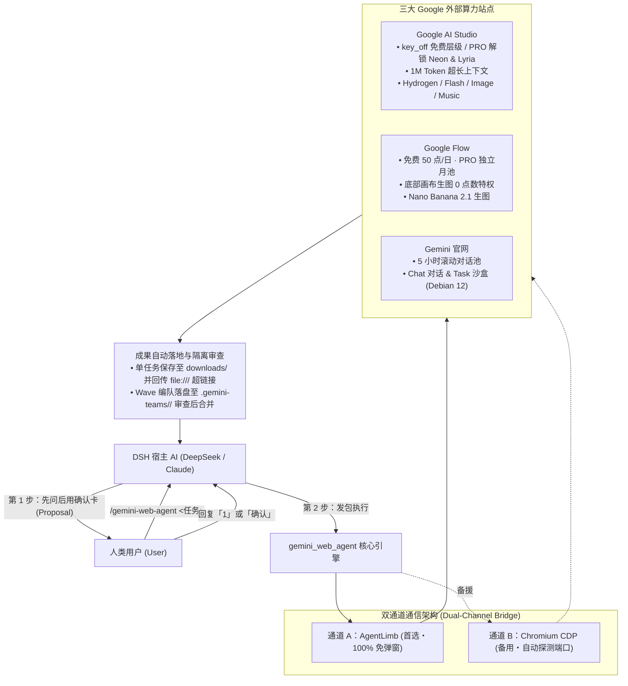

# dsh-gemini-web

[简体中文](README.md) | [English](README.en.md)

[](package.json)
[](LICENSE)
[](https://github.com/stJL/dsh-gemini-web/actions/workflows/sync-upstream.yml)
[](https://github.com/stJL/dsh-gemini-web)
[](https://python.org)
[](https://aistudio.google.com)

> **DeepSeek Harness (DSH) 原生调度插件**：专为接入 [@582835293/gemini-web-agent](https://github.com/582835293/gemini-web-agent) 多渠道网页额度生态而设计的 GUI 管理器与 Agent 工具适配器。

<!-- [图片 1 - 顶部效果预览 / Hero Banner] -->
<!-- 截图提示：DSH 聊天室中调用 Gemini Web Agent 的完整界面截图（含指令、先问后用确认卡与代码落地结果） -->


---

## 🙏 致谢与开源声明 (Credits & Attribution)

本项目诞生于开源社区的深度协同与热爱，特此向所有贡献者致以最诚挚的感谢：

* 🌟 **底层核心自动化与架构探索**：[@582835293](https://github.com/582835293)
  - 本插件底层核心浏览器自动化规则、DOM 选择器精准调校、多渠道调度逻辑与风控防护策略**100% 传承并致敬原作者 [@582835293](https://github.com/582835293) 的开源项目 [gemini-web-agent](https://github.com/582835293/gemini-web-agent)**。向原作的开拓性贡献致敬！❤️
* 🚀 **DSH 插件整合与维护**：[@stJL](https://github.com/stJL) (我)
  - 提出 DSH 整合想法，负责插件适配、全流程功能实测与开源维护。
* 🤖 **AI 协同编程**：Google DeepMind Antigravity (Gemini-3.8-flash)
  - 协助编写插件适配代码、封装路由、构建 GUI 设置面板与文档整理。

---

## 📊 功能分工与特性对照表

本项目基于原作者 [@582835293/gemini-web-agent](https://github.com/582835293/gemini-web-agent) 的底层浏览器自动化能力，为 DeepSeek Harness (DSH) 桌面端进行适配与功能扩展：

| 功能模块 | 原作者基础 (`gemini-web-agent`) | 本插件扩展 (`dsh-gemini-web` v0.4.0-alpha.1) |
| :--- | :--- | :--- |
| **操作界面** | Python 命令行（CLI）执行 | DSH 桌面端设置面板、聊天室快捷插槽（Slots）、状态指示灯与实时额度大盘 |
| **通信通道** | CDP（9222 端口）连接 | 整合 AgentLimb 免弹窗通道（多端口智能避让 `revoked`）+ CDP 多浏览器备用探测 |
| **多角色编队** | 單一任務 / 手动拼接 Wave | **虚拟工作室（Wave）**：支持主 AI 自由编排结构化 `wave_tasks` + 5 套官方与双轨自定义编队 |
| **会话隔离交付**| 直接写入目标项目目录 | `.gemini-teams/<sessionId>/` 沙盒隔离落盘、审查抽屉与一键安全合并 |
| **模型阶梯** | 固定的模型降级链 | GUI 自定义 1~5 阶模型排序（`↑`/`↓`）、智能阶梯 / 严格模式、1–5 级思考策略 |
| **AI Studio** | 网页对话与代码生成调度 | 免费号保护（过滤 `Paid`、`Extra High` 防卡死）；PRO 号自动解锁 `Neon`、`Extra High` 与 `Lyria` 音乐台 |
| **Google Flow** | 网页自动化生图 | 默认底栏画布生图（`Nano Banana 2.1` 0 点数消耗）、适配每日/每月重置检测 |
| **本地文件分析** | 基础文本输入 | 支持本地代码/日志/PDF 免弹窗挂载至 1M 窗口（自动忽略不存在的输出文件名）；`gemini-spark` 自动过滤敏感密钥 |
| **调度流程** | 脚本直接发包 | **v0.4 轻量门禁**：先问后用确认卡 + GUI 授权配置快照，确认后由主 AI 自由查阅 `references/` 并调度 |

---

## 🚨 核心召唤规范（必读）

> [!IMPORTANT]
> **必须在提示词开头输入 `/gemini-web-agent` 斜杠指令！**
> 
> DSH 宿主 AI（如 DeepSeek、Claude、GPT 等）本身具备通用的代码与文本生成能力。**若不加上 `/gemini-web-agent`，AI 会倾向于在本地直接作答，直接忽略外部工具**。
> 
> 只要在提示词开头加上 `/gemini-web-agent`，宿主 AI 就会立刻触发调度协议，严格执行流程，将任务委派给外部 Google 网页端执行！

### 💬 召唤指令范例 (Prompt Samples)

#### 1. 代码开发与架构推演（Google AI Studio）
* **指定单页精准确切模型（不被关键字误劫持）**：
  > `/gemini-web-agent 请只用 Google AI Studio 的 gemini-3.8-flash 单分页帮我写一个极简任务看板数据结构与 Python CLI 范例，不要启动 Wave 多分页，单次执行并落地存档即可。`
* **调用 Hydrogen 极限代码生成与架构设计**：
  > `/gemini-web-agent 用 Gemini 4 Hydrogen 帮我实现高性能无锁队列 (Lock-free Queue)，并附带完整中文注释与单元测试`
* **PRO 旗舰 Neon + Extra High 深度推演**：
  > `/gemini-web-agent 用 Gemini 4 Neon (extra_high) 推导分布式 Raft 共识算法在网络分区时的极限容错证明，并给出状态机伪代码`

#### 2. 多角色并发协作（Wave 虚拟工作室）
* **由主 AI 自由拆解结构化 `wave_tasks`（前端代码 + Flow 视觉素材联动）**：
  > `/gemini-web-agent 帮我做一个极简番茄钟网页（HTML/CSS/JS）。确认执行后，请依 references/ 规范自己用 wave_tasks 拆两个角色并行：一个在 AI Studio 写出并解包成 index.html，另一个在 Google Flow 用 Nano Banana 2.1 生一张极简扁平番茄图标，最后存进会话隔离目录让我检查后再合并。`
* **调用内置官方研发编队卡（5 套可选）**：
  > `/gemini-web-agent 启动 web_fullstack_app 全栈研发编队，开发一个带本地 JSON 持久化的待办看板 Web 应用`
  > `/gemini-web-agent 启动 academic_deep_research 编队，帮我调研并撰写 2026 年端侧推理框架综述对比报告`

#### 3. 多模态生图、视频与 AI 音乐（Google Flow & Lyria）
* **Google Flow 画布 0 点数高清生图**：
  > `/gemini-web-agent 在 Google Flow 用 Nano Banana 2.1 生一张极简日式枯山水庭园 2K 壁纸`
* **Google Flow 视频生成（消耗 Flow 点数）**：
  > `/gemini-web-agent 在 Google Flow 用 Omni 1.2 生成一段 5 秒赛博朋克雨夜霓虹街景短视频`
* **Lyria AI 音乐台创作（PRO 账号专享）**：
  > `/gemini-web-agent 用 Lyria 音乐台（lyria-3-pro-preview）生成一段 10 秒舒缓的 lo-fi 钢琴循环背景音乐，完成后存档回传本机链接。`

#### 4. 本地大文件挂载与联网沙盒调研
* **巨型日志分析与论文 PDF 跨模态解读（1M 上下文零本地 Token）**：
  > `/gemini-web-agent 用 Google AI Studio 帮我分析 logs/system.log 的崩溃瓶颈，并对比 docs/paper.pdf 的架构提出优化方案`
* **Gemini 官网 `Task` 云端沙盒联网调研**：
  > `/gemini-web-agent 在 Gemini 官网切换至 task 模式，联网调研最新 AI 芯片架构进展并做成对比表格`

---

## 🆓 Google 免费账号 vs PRO 付费账号权限对照表

> 以下对照基于 **2026-11-25 实机双账号（Free & Google AI PRO）实测结果**整理。插件会自动侦测账号权限并启用对应防护，**免费账号可安心跑通主力研发、画布 0 扣点生图与多角色 Wave**，PRO 账号则会解锁旗舰推理、音乐台与原生 Task 沙盒。

| 站点 / 能力模块 | 具体模型或功能 | 免费账号 (Free) | PRO 付费账号 (Google AI PRO) | 插件自动处理 / 避坑说明 |
| :--- | :--- | :---: | :---: | :--- |
| **AI Studio 文本推理** | `gemini-4-hydrogen`（主力编码）<br>`gemini-3.8-flash` / `3.5-flash-lite`<br>`gemini-decision-1` | ✅ **可用** | ✅ **可用** | `key_off` 免费层级享 1M 上下文；拥堵时按 GUI 1~5 阶梯自动接力 |
| **AI Studio 旗舰模型** | `gemini-4-neon`、`gemini-4-argon` | ❌ **不可用**（`Paid`） | ✅ **已解锁** | 免费号遇到 `Permission Denied` 时自动安全降级至 `Hydrogen`，绝不硬撞付费墙 |
| **AI Studio 顶配付费模型** | `gemini-4-carbon`、`genie-4` | ❌ **不可用**（`Paid`） | ❌ **仍标 `Paid`** | 需在 AI Studio 绑定付费 API Key（`Pay-as-you-go`）方可使用；默认被插件过滤 |
| **AI Studio `Extra High` 思考** | `thinking_level: extra_high` | ❌ **安全锁定** | ✅ **已解锁** | 免费号强开易触发 403 / 假死，自动回退 `high`；PRO 号实测可直跑 `Neon Extra High` |
| **AI Studio 生图** | `Nano Banana 2 Lite` (`gemini-3.1-flash-lite-image`) | ✅ **可用** | ✅ **可用** | AI Studio 免费轻量生图首选 |
| **AI Studio 进阶生图** | `Nano Banana 2.1` / `Nano Banana Pro` | ❌ **不可用**（`Paid`） | ✅ **已解锁** | 免费号在 AI Studio 触发付费弹窗时，自动降级至 Flow 0 扣点或 `2 Lite` |
| **AI Studio 音乐台** | `Lyria 3.5` / `lyria-3-pro-preview`（`/new_music`） | ❌ **不可用**（`Upgrade` 锁） | ✅ **已解锁** | 免费号几秒内侦测升级锁并熔断回传 `paid_only: true`；PRO 号实测可导出 `.mp3` |
| **AI Studio 语音 / 转写** | `3.8 Flash TTS`、`3.5 Transcribe`、`Live Translate` | ✅ **可用** | ✅ **可用** | `key_off` 下免费可用 |
| **Google Flow 点数池** | 额度刷新机制 | ✅ **50 点 / 每日刷新** | ✅ **1,000+ 点 / 每月重置** | GUI 实时额度大盘自动适配每日/每月周期显示 |
| **Google Flow 画布生图** | `Nano Banana 2.1`（底部画布 `x1`） | ✅ **0 点数消耗** | ✅ **0 点数消耗** | **全账号核心福利**：底栏画布生图不扣点数，等同无限高清出图 |
| **Google Flow 视频生成** | `Omni 1.2 Flash` / `Veo 3.1 Lite` | ✅ **可用（扣点数）** | ✅ **可用（扣点数）** | 默认数量建议设为 `x1`；打开右侧 Agent 面板或生视频会扣除点数 |
| **Gemini 官网日常对话** | `gemini.google.com/app`（`Chat` 模式） | ✅ **可用（`Auto`）** | ✅ **已解锁高阶模式** | 独立 5 小时滚动池；遇到 `google.com/sorry` 人机验证立即停止并提示手动通过 |
| **Gemini 官网云端沙盒** | `Task` 模式（Debian 12 容器执行） | ⚠️ **无 `Task` 按钮** | ✅ **原生解锁** | 免费号无按钮时 3 秒识别并安全放行至对话通道；PRO 号可原生切入 `Task` 执行代码 |

> [!TIP]
> **📁 文件挂载特性亮点**：
> 本插件已完整打通「本机文件免弹窗挂载 (File Attachment)」！在提示词中指定本地日志、代码、图片或论文 PDF，宿主 AI 会在提案卡中自动标记 `- 📁 挂载文件`，并自动通过 DataTransfer / CDP 注入 Google AI Studio 1M 超大上下文进行推演，不耗费本机宿主模型的输入 Token！

---

## 🌟 核心特性与架构



### 1. 零 Token 外部免费算力池
* 充分利用本机浏览器已登录之 Google 账号网页端免费用量，不耗费本机任何 API Token 配额。
* 支持 Google AI Studio 1M 超大上下文、Google Flow 画布高清生图与 Gemini 官网联网任务。

### 2. 双通道智能路由架构 (Dual-Channel Smart Bridge)
* **通道 A (AgentLimb - 推荐首选)**：
  - ⚡ **100% 免弹窗**：基于本机配对协议直接操控已开启之浏览器，彻底告别传统 CDP 连接时频繁跳出的「Allow」授权弹窗。
  - 🛡️ **无感休眠唤醒**：自动启用标签页防冻结与唤醒机制，任务结束自动释放。
* **通道 B (Chromium CDP - 备用模式)**：
  - 免装扩展程序，自动探测遍历 Chrome、Edge、Brave、Vivaldi 等浏览器的 DevToolsActivePort，具备多实例防冲突机制。

### 3. 三大站点深度支持与免扣费安全锁
* **Google AI Studio (`aistudio.google.com`)**：
  - 默认工作于 **`key_off` 免费无限轮询层级**（左上角未绑定付费 API Key），享受 1M Token 超长上下文输出；主力编码模型为 **`gemini-4-hydrogen`**（原 `Argon` 别名已兼容自动映射至 `Hydrogen`）。
  - **防 Paid 扣费铁律**：自动识别账号实际已解锁权限，过滤仍标记为 `Paid` 的付费模型（如 `gemini-4-carbon`、`genie-4`），非用户显式指定绝不误触发扣费路径；且禁用上游静默跳级，避免免费号误切付费模型。
  - **免费 vs PRO 自动适配**：免费号锁定 `Extra High` 思考等级以防 403 / 假死；若浏览器登录 **PRO 账号**，自动识别并解锁 `gemini-4-neon`（含 `Extra High` 思考）以及 **Lyria 音乐台（`lyria-3.5` / `lyria-3-pro-preview`）** 音频生成并保存本机 `.mp3`。
* **Google Flow (`flow.google.com`)**：
  - **点数重置机制**：免费账号每日定期自动补满 50 点，PRO 账号每月享有专属点数池（如 1,000+ 点）。
  - **🎨 画布 0 点数生图特权（重要！）**：在底部标准画布（Canvas）提示词框使用 Nano Banana 2.1 / Pro 生成 2K 高清图片时，**完全不扣除点数（Generating will use 0 credits）**，等同无限免费生图！
  - **⚠️ 扣点避坑提醒**：点开右侧 Conversational Agent 对话面板（Agent 模式）或点击生成视频（Omni / Veo）时会扣除点数，日常纯生图请认准底栏画布生成。
* **Gemini 官网 (`gemini.google.com`)**：
  - 独立 5 小时滚动对话池，支持日常 `Chat` 与 `Task`（Debian 12 云端沙盒）模式；免费号若无 `Task` 按钮会自动 3 秒快速识别并安全放行，不阻塞任务与 Wave。
  - 联网开启時自动过滤本地 `.env`、`*.pem`、`*.key`、`id_rsa*` 等敏感凭证文件；若触发 `google.com/sorry` 人机验证会立即熔断提示，绝不强行绕过。

### 4. Wave 虚拟工作室、自定义编队与会话隔离 (v0.3.0-beta.1 新增)
* **🌊 多角色错峰并发与断点续传**：支持同时编排 AI Studio（架构/编码）、Gemini 官网（联网调研）与 Google Flow / Lyria（视觉/音频），默认错峰 `3.5s` 派发并维持 `1-Tab-1-Role` 持久化绑定，支持 `--resume` 断点续跑与 JSON 自动解包写档。
* **📚 双轨编队体系**：内置 5 套官方编队卡（Web 全栈、学术深研、影音内容、数据办公、互动游戏），同时支持在 GUI 使用 **「➕ 组装专属编队」** 可视化拼装，或点击 **「📂 打开编队目录」** 直接编辑 Markdown 编队文件（参考 `custom_squad.md.example`）。
* **📦 会话隔离交付与聊天室插槽**：Wave 产出优先写入当前会话专属目录 `.gemini-teams/<sessionId>/wave_<timestamp>/`，可在设置面板审查或浏览文件后点击 **「🚀 合并至项目」** 落盘；聊天室右下角与顶部亦可启用快捷插槽（`enableChatSlots`）一键唤起编队或查看团队状态。

### 5. 严格「先问后用」工作流 (Ask-Before-Dispatch)
为确保透明、可控与零意外花费，插件严格遵循规范的「先问后用」交互流程：
1. **第 1 步：呈现调度提案卡**  
   AI 接收到任务后，严禁直接发包或偷开本地 subagent，必须先输出结构化确认卡，并立即结束当次回显等待用户指令：
   ```markdown
   ### 🌐 Gemini Web Agent
   检测到您欲调用外部 Google 网页端实现并发任务，相关配置如下：

   - 🎯 执行渠道：Google AI Studio（可选择：Google AI Studio / Gemini Web）
   - 🚪 入口模式：chat
   - 🧠 执行模型：（智能/定时模式）
     - gemini-4-hydrogen -> gemini-3.8-flash -> gemini-3.5-flash-lite -> gemini.google.com
   - ⚙️ 推演配置：Thinking 设为 high
   - 🔄 话题隔离：new_chat: true（默认开启全新独立对话）

   👉 请确认是否发包执行？
   - 回复 「确认」 或 「1」：立即调用外部 Chrome 自动化发包执行
   - 回复 调整参数（如「改用 Flash Lite」、「改用 Argon」等）：按您的要求调整后直接发包
   - 回复 「取消」：中止外部调度，改由本地作答
   ```
2. **第 2 步：用户授权发包**  
   - 回复 `1` 或 `确认`：立即调用外部 Chrome 执行发包。
   - 回复 调整参数：AI 立即按最新参数直接发包。
   - 回复 `取消`：中止外部调度，改由本地直接回答。

### 6. 阶梯备援降级机制 (Sequential Fallback Ladder)
* **智能模式**：在 AI Studio 遭遇尖峰拥堵、限流或超时时，自动沿着梯队平滑降级：
  $$\text{Tier 1 (Hydrogen)} \longrightarrow \text{Tier 2 (Flash)} \longrightarrow \text{Tier 3 (Flash Lite)} \longrightarrow \text{Gemini 官网}$$
* **严格模式**：若用户在设置中切换为「🛑 严格模式」，则锁定单一模型，不进行任何降级。
* **GUI 自由调整**：在设置面板中可自由增删 1~5 阶模型，并通过 `↑` / `↓` 按钮直观调整模型优先级顺序。

### 7. 代码自动落地与点击式超链接交付
* 网页端生成的代码块与生成的媒体文件（PNG 图片、MP4 视频、MP3 音乐、项目 ZIP 包）由后台程序自动提取并落地保存至 DSH 工作区的 `downloads/` 目录。
* 输出标准可点击的本地绝对路径 Markdown 超链接：
  ```markdown
  - [lru_cache.py](file:///home/user/.../downloads/lru_cache.py)
  - [gemini_flow_1732000000.png](file:///home/user/.../downloads/gemini_flow_1732000000.png)
  ```
* 避免全量长代码在聊天窗口大量重抄导致小模型 SSE 流截断（Incomplete JSON segment）。

### 8. 本机文件、日志与论文 PDF 免弹窗挂载分析 (Multi-modal File Attachment)
* **1M Token 零开销吞吐**：通过底层 `DataTransfer`（通道 A）与 Chromium 原生 `DOM.setFileInputFiles`（通道 B），直接将本机的 `.txt`、`.log`、`.pdf`、`.py`、`.cpp` 或图片免弹窗上传至 Google AI Studio 进行端到端多模态解析。
* **彻底规避本机 Context 溢出**：本机宿主模型无需在聊天对话框中重抄或吞吐十万行日志文本，只需传入文件路径，由 Google AI Studio 免费层级（100 万 Token 窗口）全权推演分析并回传结论！
* **多文件并行挂载**：支持一次性挂载多份参考文档或对比文件。

---

## ⚙️ GUI 设置大盘功能

在 DSH 桌面端的插件设置页面中提供了一站式仪表盘：
1. **浏览器通信状态灯**：实时检测 AgentLimb（🟢 绿灯）与 CDP 备用通道连接状态、调试端口与浏览器类型。
2. **实时额度大盘**：
   - Google AI Studio：显示 `key_off` 免费层级状态。
   - Gemini 官网：显示 5 小时滚动池已用量与重置周期。
   - Google Flow：显示当前剩余点数与每日/每月重置倒计时。
3. **调度与模型梯队配置**：
   - 梯队自由排序：支持 1~5 阶模型上下移动（`↑` / `↓`）。
   - 模式切换：智能阶梯模式 vs 严格模式。
   - 思考等级配置：`high` / `medium` / `low`。

---

## 🛠️ 安装与部署指南

### 1. 插件安装

* **方式一：Git Clone 本地软链接（目前推荐）**：
  ```bash
  git clone https://github.com/stJL/dsh-gemini-web.git
  ln -s $(pwd)/dsh-gemini-web ~/.dsh/profiles/desktop/node_modules/dsh-gemini-web
  ```
* **方式二：NPM 官方源一键安装（即将推出 / Roadmap 规划中）**：
  > 🚧 **待实现目标**：本项目正筹备发布至 npm 官方源 `registry.npmjs.org`。发布完成后，届时将支持直接在 DSH 桌面端插件市场搜索一键安装，或通过命令行安装：
  > ```bash
  > # 即将支持 (Upcoming)
  > pnpm add dsh-gemini-web
  > ```

### 2. Python 环境与依赖
插件依赖 Python 3.10+ 与 Playwright 驱动：
```bash
cd /path/to/dsh-gemini-web
python3 -m venv .venv
source .venv/bin/activate
pip install -r requirements.txt
playwright install chromium
```

### 3. 浏览器准备（二选一）
* **方案 A（推荐）**：安装并启用 AgentLimb 浏览器扩展，享受 100% 免弹窗静默通信。
* **方案 B**：以调试模式启动本机 Chrome / Edge：
  ```bash
  google-chrome --remote-debugging-port=9222
  ```

### 4. 部署 Skill（AI 指导规范）
执行内置部署脚本，自动将 Skill 注册至 DSH 与 Antigravity：
```bash
python scripts/setup_skill.py --auto
```

---

## 💡 使用建议与最佳实践 (Best Practices & Account Safety)

为确保您获得最稳定、流畅且安全的自动化调度体验，强烈建议遵循以下实践原则：

### 1. 建议优先开启全新独立对话 (Prefer New Chat)
* **规避长上下文与注意力衰减**：当前聊天室的历史轮次累积过长时（尤其是超过数万 Token），轻量级宿主模型（如 8B 级别的小模型）极易受到上一轮历史助手的输出惯性吸引（In-Context Few-Shot Bias），进而可能忽略顶部最新动态提示词。
* **确保实时配置百分之百生效**：在 DSH 左侧随时点击 **「新建对话（New Chat）」**，能彻底清除历史对话的干扰，确保宿主 AI 100% 严格以您在 GUI 面板中设置的最新模型降级顺序、思考等级与挂载参数进行输出。

### 2. 账号安全：强烈建议使用专用/备用 Google 账号 (Use Secondary Accounts)
> [!WARNING]
> **切勿使用绑定了重要个人隐私、公司业务、核心 Gmail 邮箱或 Google Drive 关键文件的日常主力账号！**
* **自动化行为与风控机制**：本插件本质上属于浏览器自动化辅助工具（通过 AgentLimb 或 CDP 驱动）。若在短时间内触发大量并发调度、极高频发包或密集挂载超大文件，Google 服务器的安全风控机制可能会触发临时人机验证（CAPTCHA）、请求频率限制（Rate Limit），甚至可能导致账号在网页端暂时无法使用。
* **专用测试账号隔离**：强烈建议专门注册一个或多个**独立的备用/测试 Google 账号（Secondary / Disposable Account）**登录 Chrome 浏览器来进行插件调度。这样即便遇到临时频率风控，也不会对您的日常生活与工作产生任何不良影响。

---

<details>
<summary>🛠️ <b>维护者指南：上游同步与 CI/CD (Maintainer Guide)</b></summary>

> [!NOTE]
> 本节内容仅供插件维护者开发使用，普通用户无需执行。

本插件采用**模块化分离架构**，让底层自动化脚本能无痛跟进原作者 [@582835293/gemini-web-agent](https://github.com/582835293/gemini-web-agent) 的更新，同时保证 DSH GUI 与插件核心不受影响。

### 架构分离设计
* **底层自动化脚本 (`scripts/`)**：源自原作者仓库（`gemini_web.py`、`gemini_agentlimb.py`、`platform_utils.py` 等），负责 DOM 选择器与网页交互。
* **DSH 插件专属层 (`src/`, `client.js`, `index.js`, `cordis.patch.yml`)**：负责 DSH GUI 面板、MCP 服务注册、动态 Prompt 注入与阶梯降级逻辑。

### 一键同步指令
我们在项目中提供了自动化同步脚本，随时拉取原作者最新选择器修复：
```bash
# 执行一键同步脚本
npm run sync:upstream
# 或
python scripts/sync_upstream.py
```
同步脚本会自动完成：
1. 从原作者 GitHub 上游仓库获取最新代码。
2. 比对并更新 `scripts/` 下的自动化脚本与最新选择器。
3. 自动保留 DSH 增强特性（如 Flow 每日点数重置正则适配）。
4. 重新构建插件产物（`bun build`）。

### GitHub Actions 自动同步
本项目已配置 `.github/workflows/sync-upstream.yml`，每周自动检查上游更新并产生 PR，维护者可直接在 GitHub 线上审核合并。详细的本地兼容性测试流程请参阅 [docs/UPSTREAM_SYNC_GUIDE.md](docs/UPSTREAM_SYNC_GUIDE.md)。
</details>

---

## 🤝 欢迎参与测试、反馈与贡献 (Feedback & Contribution)

> [!NOTE]
> 💡 **项目状态与版本说明（`v0.3.0-beta.1` / `v0.4.0-alpha.1`）**：  
> - `main` 分支稳定停留于 **`v0.3.0-beta.1`**（Public Beta 里程碑）。  
> - 当前分支正推进 **`v0.4.0-alpha.1`** 长期底座重构：**「只守最基本的安全门禁 + 把上游变成给 DSH 主 AI 自由调度的独立多 Agent 算力平台」**。  
> 由于 Google 各大网页端（AI Studio、Gemini 官网、Google Flow / Lyria）会不定期进行界面调整或风控策略变化，加上操作系统与账号等级（免费 / PRO）差异，欢迎随时提交实测反馈与建议！

> [!TIP]
> 🌱 **写给开源社区的一封信（关于 Vibe Coding）**：  
> 本项目是作者人生中**第一个真正意义上的「Vibe Coding」项目**——在与 AI（Antigravity / Gemini-3.8-flash）高频协同结对的过程中，以纯粹的直觉、热爱与工程探索驱动，一行行跨越了 Chromium 底层协议、DSH 生态适配、成果自动落盘交付与动态提示词工程。  
> 由于作者与 AI 在这场探索中仍处于不断学习与成长之中，若代码架构或实现细节中存在不够优雅、稚嫩或考虑不周之处，**恳请 GitHub 上的各路技术大神多多包涵、高抬贵手，更诚挚期盼您的指点与赐教**！无论是指出架构缺陷、提出重构建议，还是提交微小的修复 PR，我们都满怀敬畏与感激！🙏

📢 **我们非常渴望听见社区的声音，期待您的参与：**
* 🐛 **遇到 Bug 或调度失败？** 非常欢迎至 [GitHub Issues](https://github.com/stJL/dsh-gemini-web/issues) 提交反馈！请尽量附上错误日志或截图，我们会以最快速度排查与修复。
* 💡 **有更好的点子或优化建议？** 无论是调度策略、确认卡排版、UI 仪表盘交互，欢迎随时开启 Discussion 或发起 Issue 畅所欲言！
* 🛠️ **想一起完善代码？** 我们极度欢迎各路好手提交 [Pull Request](https://github.com/stJL/dsh-gemini-web/pulls)！无论是修复微小拼写、改善路径解析容错、优化 DOM 选择器适配，还是新增跨平台测试用例，每一个 PR 都是对开源社区巨大的帮助！

---

## ⚠️ 免责声明 (Disclaimer)

在安装、部署或使用本插件（`dsh-gemini-web`）之前，请务必仔细阅读本免责声明：

1. **用途声明**：本项目仅供个人技术学习、自动化整合研究与学术交流使用，切勿用于任何违反法律法规或恶意破坏服务的场景。
2. **非官方关联**：本插件为独立的第三方开源软件，与 Google LLC 及其母公司 Alphabet Inc. 不存在任何形式的官方关联、授权或背书。文中所提及的 Google、Gemini、AI Studio、Google Flow 等商标均归属于其各自的商标所有权人。
3. **服务条款与账号风险**：用户应自行遵守 Google 的《服务条款》（Terms of Service）、各项网页产品政策及所在国家/地区的法律规范。使用本工具进行浏览器自动化操作可能面临 Google 网页端的风控检测、人机验证挑战（CAPTCHA）、速率限制（Rate Limit）、功能降级或账号暂时/永久受限等风险。**所有因自动化调度行为引发的账号状态变更或服务中断风险，均由使用者本人完全自行承担。**
4. **数据安全与隐私**：在调度外部网页端或挂载本地文件时，请确保上传的文件不包含任何敏感商业机密、个人隐私数据、API 密钥或关键凭证。本项目不对上传至外部服务器的任何数据安全性承担责任。
5. **责任免除**：在适用法律允许的最大范围内，本项目的作者、维护者及社区贡献者概不对因使用、误用或无法使用本软件所引起的任何直接、间接、附带、衍生、惩罚性或特殊损失（包括但不限于账号封禁、数据丢失、业务中断、利润损失或计算机系统故障）承担任何法律责任。

一旦您安装、复制、修改或使用本项目，即表示您已完整阅读、理解并完全接受上述免责条款。

---

## 📄 授权条款 (License)

本项目遵循 MIT License。  
核心自动化逻辑版权归原作者 [@582835293](https://github.com/582835293) 所有，DSH 插件整合层归 DeepSeek Harness 社区所有。
