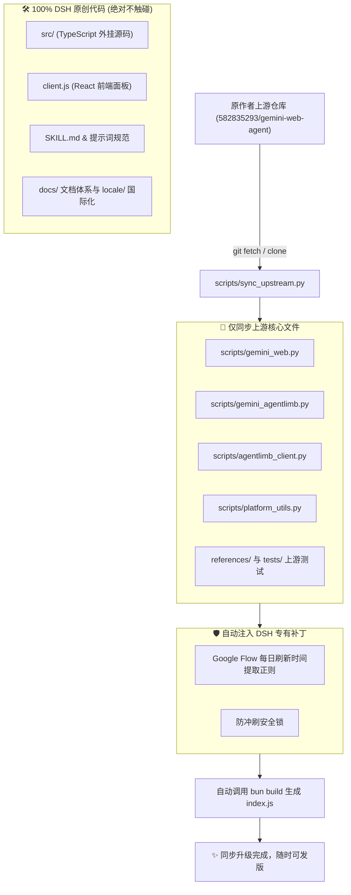

# 项目文件目录与归属架构一览 (Directory Structure & Codebase Attribution)

本文档详细梳理了 `dsh-gemini-web` 专案中的全部文件夹与核心文件，并明确标示每一部分的**代码来源、归属权（上游原作者 vs 本项目自研）**以及自动化同步规则。

---

## 📌 一、代码归属与图例说明

在目录树与分类表中，使用以下标识清晰界定文件来源：

| 标记符号 | 归属分类 | 详细说明 | 同步处理策略 |
| :---: | :--- | :--- | :--- |
| 🔄 | **上游原作者同步 (Upstream)** | 源自原作者仓库 [`582835293/gemini-web-agent`](https://github.com/582835293/gemini-web-agent) 的核心驱动或参考资源。 | 由 `scripts/sync_upstream.py` 自动拉取更新覆盖。 |
| 🛡️ | **上游同步 + DSH 专有补丁 (Patched Upstream)** | 核心逻辑来自原作者，但为了深度适配 DSH 平台环境，注入了专有正则/逻辑补丁。 | 同步脚本拉取后会自动重新应用补丁，防止冲刷丢失。 |
| 🛠️ | **DSH 本地原创研发 (DSH Native)** | 完全由本项目团队根据 DeepSeek Harness (Cordis) 架构自主研发的外挂层、UI 与调度系统。 | 属于本项目核心资产，上游同步绝对不触碰。 |
| ⚙️ | **专案配置与依赖 (Config & Project)** | 插件清单、npm 依赖描述、Git 配置等。 | 本地管理，独立维护。 |
| 📁 | **运行期与产物目录 (Runtime Artifacts)** | 编译产物、本地工作区落盘文件、Python 虚拟环境。 | 属于临时或构建产物，纳入 `.gitignore` 或动态生成。 |

---

## 🌳 二、完整目录树一览

```text
dsh-gemini-web/
├── 🛠️ client.js                       # [DSH 原创] 前端设置面板 (React ModuleLoader 单文件 bundle，1800+ 行)
├── 🛠️ cordis.patch.yml                 # [DSH 原创] Cordis 平台插件注入与补丁清单
├── ⚙️ package.json                    # [DSH 原创] 专案 npm 清单与 DSH 外挂平台绑定声明
├── 📁 index.js                         # [DSH 构建产物] Node.js 运行时入口 (由 src/index.ts 编译)
├── ⚙️ LICENSE                         # MIT 开源许可证
├── ⚙️ requirements.txt                 # Python 运行时依赖清单 (playwright, curl_cffi 等)
├── 🛠️ README.md                       # [DSH 原创] 中文官方专案说明
├── 🛠️ README.en.md                    # [DSH 原创] 英文官方专案说明
├── 🛠️ SKILL.md                        # [DSH 原创] 面向 Antigravity / DSH Agent 的英文调度技能定义
├── 🛠️ SKILL.zh-CN.md                  # [DSH 原创] 面向 Antigravity / DSH Agent 的中文调度技能定义
│
├── 📁 docs/                           # [DSH 原创] 架构文档与维护指南
│   ├── 🛠️ DIRECTORY_STRUCTURE.md      # 本文档：目录结构与代码归属一览
│   ├── 🛠️ VERSIONING_GUIDE.md         # 语义化版本管理规范 (SemVer 2.0.0)
│   ├── 🛠️ UPSTREAM_SYNC_GUIDE.md      # 一键同步原作者仓库与补丁防冲刷指南
│   ├── 🛠️ easter.md                   # 开发者设置大盘彩蛋设计与心路历程
│   └── 🛠️ images/                     # 预览截图与架构示意图
│
├── 📁 locale/                         # [DSH 原创] DSH 设置面板多语言国际化词典 (i18n)
│   ├── 🛠️ zh-CN.json                  # 简体中文语言包
│   ├── 🛠️ zh-TW.json                  # 繁体中文语言包
│   └── 🛠️ en-US.json                  # 英文语言包
│
├── 📁 src/                            # [DSH 原创] DSH 外挂核心 TypeScript 源码 (100% 自研)
│   ├── 🛠️ index.ts                    # 插件主入口：注册 Cordis 服务、系统提示词、预览与执行工具、REST 路由
│   ├── 🛠️ proposal.ts                 # 确定性提案解析引擎：优先级瀑布流、模型阶梯、零幻觉 Markdown 卡片
│   ├── 🛠️ config.ts                   # 本地配置加载与热更新校验器
│   ├── 🛠️ bridge/                     # Node.js 与 Python 子进程通信桥接
│   │   ├── 🛠️ agent-executor.ts       # 子进程执行调度器、参数转义与产物自动抽取移动
│   │   ├── 🛠️ detector.ts             # 本机 Chrome / Brave / Edge 安装路径与端口侦测
│   │   └── 🛠️ runner.ts               # 底层异步进程执行辅助工具
│   ├── 🛠️ adapter/                    # 平台模型适配层
│   │   └── 🛠️ gemini-adapter.ts       # 外部模型提供者抽象适配
│   └── 🛠️ transport/                  # REST API 传输层
│       └── 🛠️ router.ts               # 后端 API 路由 (供前端面板轮询配额、执行连通测试)
│
├── 📁 scripts/                        # 驱动脚本与自动化工具
│   ├── 🛡️ gemini_web.py               # [上游核心+DSH补丁] Google AI Studio / Gemini 官网浏览器自动化
│   ├── 🛡️ gemini_agentlimb.py          # [上游核心+DSH补丁] Google Flow 生图与生视频浏览器自动化
│   ├── 🔄 agentlimb_client.py         # [上游核心] AgentLimb 通信客户端
│   ├── 🔄 platform_utils.py           # [上游核心] 跨平台浏览器定位与系统兼容库
│   ├── 🔄 setup_skill.py              # [上游核心] 原生环境初始化与 Skill 辅助
│   ├── 🛠️ sync_upstream.py            # [DSH 原创] 一键同步上游仓库脚本 (支持拉取、比对、防冲刷、编译)
│   ├── 🛠️ inspect_antigravity.py      # [DSH 原创] DSH / Antigravity 运行环境诊断与自省工具
│   └── 🛠️ dsh_sprite_slicer.py        # [DSH 原创] 彩蛋图标切片生成辅助工具
│
├── 📁 references/                     # [上游同步] 参考文档与实战剧本 (100% 同步自原作者)
│   ├── 🔄 models.md                   # 各站点模型代号与特性说明
│   ├── 🔄 agentlimb.md                # AgentLimb 架构机制解析
│   ├── 🔄 director_prompt.md          # 导演级系统提示词设计参考
│   └── 🔄 playbooks/                  # 行业分类应用剧本 (学术研究/音视频/办公自动化/全栈开发等)
│
├── 📁 tests/                          # 测试套件 (混合架构)
│   ├── 🔄 test_core.py                # [上游同步] Python 核心底层单元测试
│   ├── 🔄 test_perf_and_dom.py        # [上游同步] DOM 解析与自动化性能基准测试
│   ├── 🛠️ proposal.test.ts            # [DSH 原创] Bun 测试：确定性提案卡解析、站点优先级与 Argon 映射
│   └── 🛠️ command.test.ts             # [DSH 原创] Bun 测试：单一门禁指令与提案格式校验
│
├── 📁 downloads/                      # [运行时产物] 外部 Google 网页端生成并下载的文件落盘工作区
└── 📁 .venv/                          # [运行时产物] Python 隔离虚拟环境 (符号链接至系统运行环境)
```

---

## 🔍 三、各功能模块详细拆解

### 1. `src/` (DSH 原创 TypeScript 核心层)
* **归属**：**100% DSH 本地原创**。
* **职责**：
  * **`src/index.ts`**：插件生命周期核心。向 DSH 容器注册服务，注入动态提示词段落 (`gemini-web:card-guidance`)，注册 `gemini_preview` 与 `gemini_web_agent` 核心工具，并挂载 WebServer API 路由。
  * **`src/proposal.ts`**：彻底终结小模型排版幻觉的核心利器。纯 TypeScript 编写的确定性解析器，严格根据规则优先级（AI Studio 显式指定 > Flow 生图/视频 > 官网 Task 联网搜索）生成绝对标准、格式严谨的提案卡 Markdown，并自动处理旧版代号（如 `Argon` ➜ `Hydrogen`）。
  * **`src/bridge/agent-executor.ts`**：执行引擎。负责唤起隔离 Python 进程执行自动化，捕获流式输出，并在任务完成时自动提取产物文件移动至 `downloads/` 目录，生成合法的 `file:///` 可点击超链接。
  * **`src/transport/router.ts`**：为 DSH 客户端提供轻量级 REST API，包括 `/api/gemini-web/settings`（配置管理）、`/api/gemini-web/test`（一键连通测试）、`/api/gemini-web/quota-status`（配额获取）。

---

### 2. `client.js` 与 `locale/` (DSH 原创前端设置面板)
* **归属**：**100% DSH 本地原创**。
* **职责**：
  * **`client.js`**：针对 DSH 侧边栏 564px 极窄视口量身定制的单文件 React UI 组件。零外部 npm 构建依赖，通过 DSH 内置 ModuleLoader 原生加载运行。
  * **功能特性**：
    * 实时大盘：展示各渠道配额点数、刷新倒计时与连通状态。
    * 一键实战测试：可直接指定渠道和模型发包自测。
    * 完整参数配置：浏览器路径、Thinking 等级、超时策略、下载目录。
    * 开发者彩蛋：点击版本号触发致敬互动彩蛋。
  * **`locale/`**：支持 `zh-CN`、`zh-TW`、`en-US` 三种语言，跟随 DSH 宿主语言无缝动态切换。

---

### 3. `scripts/` (底层执行脚本与自动化同步器)
* **归属**：**上游同步 + 本地补丁与工具**。
* **详细明细**：
  * **`scripts/gemini_web.py` (🛡️ 上游+补丁)**：负责与 Google AI Studio、Gemini 官网进行 Playwright 浏览器自动化交互，包括登录态检测、会话创建、多模态附件上传与生成流监听。
  * **`scripts/gemini_agentlimb.py` (🛡️ 上游+补丁)**：负责 Google Flow 站点的自动化驱动，支持 Nano Banana 0 扣点生图以及视频生成。
  * **`scripts/agentlimb_client.py` (🔄 上游同步)**：底层通信辅助模块。
  * **`scripts/platform_utils.py` (🔄 上游同步)**：平台路径与浏览器发现工具。
  * **`scripts/sync_upstream.py` (🛠️ DSH 原创)**：**整个项目的同步中枢**。只需运行 `python scripts/sync_upstream.py`，即可安全拉取原作者仓库最新修复，并自动应用 DSH 专有补丁与执行编译。

---

### 4. `references/` (上游知识库与行业剧本)
* **归属**：**100% 同步自上游原作者**。
* **职责**：
  * 提供 Google 原生模型的深度能力对照表（`models.md`）。
  * 提供经过实战检验的高质量 Prompt 模板与各行各业落地剧本（`playbooks/`），供 Agent 查阅参考。

---

### 5. `tests/` (自动化回归测试套件)
* **归属**：**混合架构**。
* **详细明细**：
  * **`tests/test_core.py` (🔄 上游同步)**：原作者提供的 Python 单元测试，验证浏览器驱动与 DOM 交互。
  * **`tests/test_perf_and_dom.py` (🔄 上游同步)**：原作者提供的性能与 DOM 解析基准测试。
  * **`tests/proposal.test.ts` (🛠️ DSH 原创)**：Bun 测试套件，覆盖提案卡确定性解析、优先级级联与模型回退。
  * **`tests/command.test.ts` (🛠️ DSH 原创)**：Bun 测试套件，覆盖单一门禁指令与格式校验。

---

## 🔄 四、上游同步运作机制与安全准则

为了在持续吸收原作者优秀成果（如 Google DOM 变更修复、新模型支持）的同时，确保 DSH 专属特性与定制开发绝不被冲刷损坏，本项目建立了一套严格的同步准则：



### 执行上游同步指令
在 `dsh-gemini-web` 目录下执行：
```bash
python scripts/sync_upstream.py
```
同步脚本将自动完成拉取、智能比对、补丁校验与产物重新构建，全流程安全可控！
