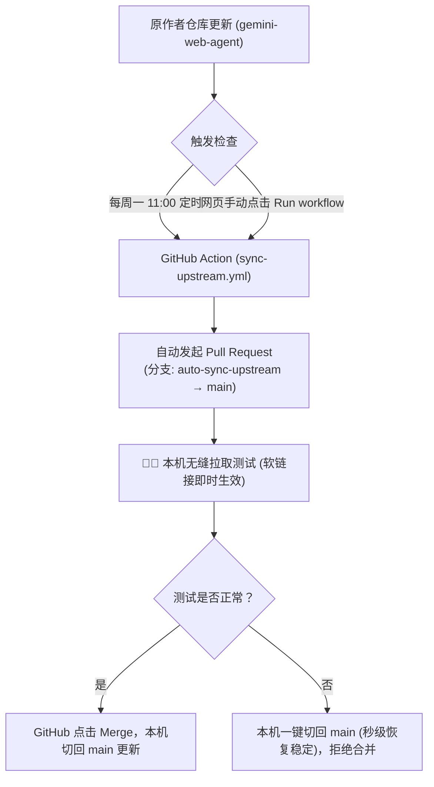

# 上游同步与本机兼容性测试流程指南

本指南记录了当原作者仓库（`582835293/gemini-web-agent`）更新时，如何安全地在本机进行兼容性测试、确认无误后再合并的全套流程。

---

## 1. 整体机制总览

为了保证 DSH 插件的生产稳定性，本项目设计了 **「安全隔离网」** 机制：



> [!IMPORTANT]
> **绝对不会直接覆盖 `main` 主分支**：GitHub Actions 只会自动创建一个 PR，是否合并的主动权完全掌握在您手中。

---

## 2. 本机测试兼容性（3 步简易流程）

当你在 GitHub 收到新的 PR 通知，或想手动测试最新同步分支时：

### 步骤 1：拉取并切换到同步分支
打开终端（Terminal），执行以下命令：
```bash
cd ~/Documents/deepseek-harness/default-workspace/dsh-gemini-web
git fetch origin
git checkout auto-sync-upstream
```
> [!NOTE]
> **为什么这样就能测？**
> 因为 DSH 的插件目录是通过软链接（Symlink）直接连接到这个工作区目录的。当你切换到 `auto-sync-upstream` 时，DSH 客户端就会**立刻即时运行该分支的最新代码**，无需重新打包安装！

---

### 步骤 2：执行自动化单体测试
在终端执行测试套件，验证底层脚本、选择器及解析逻辑：
```bash
.venv/bin/python -m unittest discover tests/
```
- **预期结果**：看到类似 `Ran 24 tests in 1.5s ... OK` 即代表核心单体测试全部通过。

---

### 步骤 3：DSH 客户端真实测试
1. 打开 DSH 桌面客户端。
2. 发送一条日常测试指令，例如：
   ```text
   /gemini-web-agent 请简短回复一段 1+1=2 的验证测试
   ```
3. 观察：
   - 浏览器是否顺畅调用与连接
   - 回答是否完整回传给 DSH
   - 画面与 Token 统计是否正常展示

---

## 3. 测试后决策处理

### 场景 A：测试完全通过（兼容良好）
1. 打开 GitHub 仓库的 Pull Request 页面：
   👉 [https://github.com/stJL/dsh-gemini-web/pulls](https://github.com/stJL/dsh-gemini-web/pulls)
2. 点击绿色的 **「Merge pull request」** 并确认合并。
3. 回到本机终端，切回主分支并拉取最新状态：
   ```bash
   git checkout main
   git pull origin main
   ```
   🎉 此时你的本机主分支与线上皆已平滑更新至最新版！

---

### 场景 B：发现报错或不兼容（原作者大幅变动）
1. **千万不要点击 GitHub 的 Merge！**
2. 本机终端立刻切回稳定的主分支：
   ```bash
   git checkout main
   ```
   ⚡ **秒级恢复**：你的 DSH 客户端立刻恢复使用完全正常的稳定版，完全不会影响日常工作。
3. 在 GitHub PR 页面：
   - 可以直接点击 **「Close pull request」** 关掉该次更新；或者
   - 在该分支上排查修复后，再 `git push` 到该 PR 分支重新测试。

---

## 4. 常用速查命令一览

| 目的 | 命令 |
| :--- | :--- |
| **切换到 PR 测试分支** | `git fetch origin && git checkout auto-sync-upstream` |
| **执行单元测试** | `.venv/bin/python -m unittest discover tests/` |
| **一键切回稳定版 (安全撤退)** | `git checkout main` |
| **合并后更新本机 main** | `git checkout main && git pull origin main` |
| **查看当前处于哪个分支** | `git branch` |
